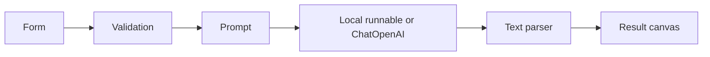

# Understand the program
## Imports
`os` reads the key from environment variables. `time` measures elapsed execution time. `Path` locates .env beside app.py regardless of working directory. `load_dotenv` loads local settings without overwriting existing variables. `streamlit` creates the browser UI. `ChatPromptTemplate` builds role-based messages. `StrOutputParser` turns model messages into text. `RunnableLambda` adapts a Python function into a composable runnable. `ChatOpenAI` connects to OpenAI in live mode.

## Important steps
`load_dotenv(..., override=False)` keeps injected configuration authoritative. `LANGUAGES` and `TONES` define supported choices. `demo_response` reads the formatted human message and produces a predictable response. `greet` strips whitespace and rejects empty, oversized, multiline, and unsupported input. The live branch checks for a key before constructing a model with a timeout and bounded retry.

`ChatPromptTemplate.from_messages` separates behavior instructions from variable input. The `|` operator connects prompt, runnable, and parser. `invoke` executes the chain with named variables. This is modern runnable composition rather than legacy LLMChain usage. It does not use create_agent because this lesson has no tool loop.

`main` configures the page before rendering it. Static CSS styles the shell; user content is rendered through Streamlit widgets rather than HTML interpolation. The form batches input changes into one submission. Session state preserves the last response, with its settings. Errors clear old results; provider errors show a safe message rather than raw details that could contain secrets. The broad UI error handler prevents an exception from breaking the learning session; it is not a claim that every failure has been diagnosed.

Demo greeting words are translated; closing sentences remain English. Live results are nondeterministic. The elapsed timer is a local wall-clock duration, not token or cost instrumentation. Names are sent to OpenAI only in live mode. No conversation history, tool calling, autonomous planning, or persistent memory exists in this lesson.
