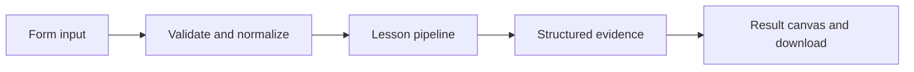

# How A conversation begins works

A compact chat studio that exchanges role-based messages and keeps the current browser session in view.

## Why LangChain
LangChain supplies composable messages, prompts, model adapters, documents, or retrieval contracts. Pure local processing may be simpler without it; the lesson isolates the named engineering concept before introducing external services.

## Imports
`Path` resolves local configuration; `os` reads variable names; `json` encodes evidence; `time` measures local duration; `streamlit` renders the interface; `load_dotenv` loads optional configuration without replacing injected values. `ChatPromptTemplate` structures messages; `StrOutputParser` extracts text; `RunnableLambda` wraps Python functions; message classes represent chat roles; `ChatOpenAI` is used only by offered live paths. Additional concept-specific imports appear in the source below.

## Data flow


## Concept-specific implementation, annotated by source
Read this complete runnable core alongside app.py. Validation precedes processing; the returned dictionary defines what the UI displays.

```python
def run(data,live=False,model=None):
    message=require_text(data['message'],2000)
    history=data.get('history',[])
    if not isinstance(history,list) or len(history)>40: raise ValueError('Reset after 20 turns.')
    messages=[SystemMessage(content='You are a concise learning assistant.')]
    for row in history:
        if row['role'] not in ('user','assistant'): raise ValueError('Invalid history role.')
        messages.append(HumanMessage(content=row['content']) if row['role']=='user' else AIMessage(content=row['content']))
    messages.append(HumanMessage(content=message))
    reply=(model if model is not None else openai_model()).invoke(messages).content if live or model is not None else 'Local assistant: You said "'+message+'". Try asking a focused learning question.'
    return {'answer':reply,'history':history+[{'role':'user','content':message},{'role':'assistant','content':reply}],'turns':len(history)//2+1}
```

## Important lines
- `def run(data,live=False,model=None):` — defines a callable stage and its input contract.
- `reply=(model if model is not None else openai_model()).invoke(messages).content if live or model is not None else 'Local assistant: You said "'+message+'". Try asking a focused learning question.'` — executes the composed pipeline with the prepared input.
- `return {'answer':reply,'history':history+[{'role':'user','content':message},{'role':'assistant','content':reply}],'turns':len(history)//2+1}` — returns the observable result consumed by tests and the evidence canvas.

## Interface and reliability
The form submits related inputs together. Session state retains the last result; reset clears it. A spinner provides loading feedback. Input errors are shown in context; unknown provider errors are sanitized. Static HTML styles contain no user text. Every output carries explicit local/live labeling. The timer is not a provider latency benchmark. Local tests do not establish live provider correctness, visual browser quality, or production deployment.
