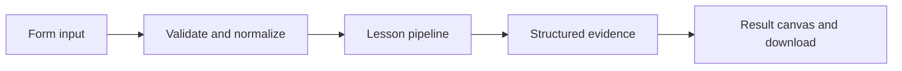

# How The prompt workshop works

Preview a role-based template with variables, without confusing formatting with model execution.

## Why LangChain
LangChain supplies composable messages, prompts, model adapters, documents, or retrieval contracts. Pure local processing may be simpler without it; the lesson isolates the named engineering concept before introducing external services.

## Imports
`Path` resolves local configuration; `os` reads variable names; `json` encodes evidence; `time` measures local duration; `streamlit` renders the interface; `load_dotenv` loads optional configuration without replacing injected values. `ChatPromptTemplate` structures messages; `StrOutputParser` extracts text; `RunnableLambda` wraps Python functions; message classes represent chat roles; `ChatOpenAI` is used only by offered live paths. Additional concept-specific imports appear in the source below.

## Data flow


## Concept-specific implementation, annotated by source
Read this complete runnable core alongside app.py. Validation precedes processing; the returned dictionary defines what the UI displays.

```python
def run(data,live=False,model=None):
    topic=require_text(data['topic'],200);audience=require_text(data['audience'],200)
    style=require_text(data['style'],100)
    prompt=ChatPromptTemplate.from_messages([('system','Teach {audience} using a {style}.'),('human','Explain {topic}.')])
    formatted=prompt.invoke(dict(topic=topic,audience=audience,style=style))
    messages=[{'role':m.type,'content':m.content} for m in formatted.to_messages()]
    answer=StrOutputParser().invoke((model if model is not None else openai_model()).invoke(formatted)) if live or model is not None else formatted.to_string()
    return {'answer':answer,'messages':messages,'variables':sorted(prompt.input_variables)}
```

## Important lines
- `def run(data,live=False,model=None):` — defines a callable stage and its input contract.
- `formatted=prompt.invoke(dict(topic=topic,audience=audience,style=style))` — executes the composed pipeline with the prepared input.
- `answer=StrOutputParser().invoke((model if model is not None else openai_model()).invoke(formatted)) if live or model is not None else formatted.to_string()` — executes the composed pipeline with the prepared input.
- `return {'answer':answer,'messages':messages,'variables':sorted(prompt.input_variables)}` — returns the observable result consumed by tests and the evidence canvas.

## Interface and reliability
The form submits related inputs together. Session state retains the last result; reset clears it. A spinner provides loading feedback. Input errors are shown in context; unknown provider errors are sanitized. Static HTML styles contain no user text. Every output carries explicit local/live labeling. The timer is not a provider latency benchmark. Local tests do not establish live provider correctness, visual browser quality, or production deployment.
