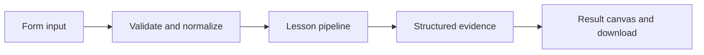

# How Words across borders works

Translate common phrases locally, or translate arbitrary text through an optional live model.

## Why LangChain
LangChain supplies composable messages, prompts, model adapters, documents, or retrieval contracts. Pure local processing may be simpler without it; the lesson isolates the named engineering concept before introducing external services.

## Imports
`Path` resolves local configuration; `os` reads variable names; `json` encodes evidence; `time` measures local duration; `streamlit` renders the interface; `load_dotenv` loads optional configuration without replacing injected values. `ChatPromptTemplate` structures messages; `StrOutputParser` extracts text; `RunnableLambda` wraps Python functions; message classes represent chat roles; `ChatOpenAI` is used only by offered live paths. Additional concept-specific imports appear in the source below.

## Data flow


## Concept-specific implementation, annotated by source
Read this complete runnable core alongside app.py. Validation precedes processing; the returned dictionary defines what the UI displays.

```python
def run(data,live=False,model=None):
    text=require_text(data['text'],2000);language=data['language']
    phrases={'hello':{'Spanish':'Hola','French':'Bonjour'},'thank you':{'Spanish':'Gracias','French':'Merci'},'goodbye':{'Spanish':'Adiós','French':'Au revoir'}}
    if language not in ('Spanish','French'): raise ValueError('Choose Spanish or French.')
    if live or model is not None: answer=ask('Translate the user text to '+language+'. Return only the translation.',text,model)
    else:
        if text.casefold() not in phrases: raise ValueError('Local phrasebook supports Hello, Thank you, and Goodbye. Use live mode for other text.')
        answer=phrases[text.casefold()][language]
    return {'answer':answer,'language':language,'method':'model' if live or model is not None else 'local phrasebook'}
```

## Important lines
- `def run(data,live=False,model=None):` — defines a callable stage and its input contract.
- `return {'answer':answer,'language':language,'method':'model' if live or model is not None else 'local phrasebook'}` — returns the observable result consumed by tests and the evidence canvas.

## Interface and reliability
The form submits related inputs together. Session state retains the last result; reset clears it. A spinner provides loading feedback. Input errors are shown in context; unknown provider errors are sanitized. Static HTML styles contain no user text. Every output carries explicit local/live labeling. The timer is not a provider latency benchmark. Local tests do not establish live provider correctness, visual browser quality, or production deployment.
