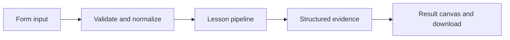

# How Read the mood works

Inspect a transparent lexicon baseline and optionally compare it to model classification.

## Why LangChain
LangChain supplies composable messages, prompts, model adapters, documents, or retrieval contracts. Pure local processing may be simpler without it; the lesson isolates the named engineering concept before introducing external services.

## Imports
`Path` resolves local configuration; `os` reads variable names; `json` encodes evidence; `time` measures local duration; `streamlit` renders the interface; `load_dotenv` loads optional configuration without replacing injected values. `ChatPromptTemplate` structures messages; `StrOutputParser` extracts text; `RunnableLambda` wraps Python functions; message classes represent chat roles; `ChatOpenAI` is used only by offered live paths. Additional concept-specific imports appear in the source below.

## Data flow


## Concept-specific implementation, annotated by source
Read this complete runnable core alongside app.py. Validation precedes processing; the returned dictionary defines what the UI displays.

```python
import re
from pydantic import BaseModel
from typing import Literal
class Sentiment(BaseModel):
    label:Literal['positive','negative','neutral']
    reason:str

def run(data,live=False,model=None):
    text=require_text(data['text'],4000)
    if live or model is not None:
        judged=(model if model is not None else openai_model()).with_structured_output(Sentiment).invoke('Classify sentiment with a brief reason: '+text)
        return {'answer':judged.label,'reason':judged.reason,'method':'structured model judgment'}
    tokens=re.findall(r'[a-z]+',text.lower());positive={'love','great','helpful','excellent','good'};negative={'hate','bad','slow','broken','awful'}
    plus=[t for t in tokens if t in positive];minus=[t for t in tokens if t in negative];score=len(plus)-len(minus)
    return {'answer':'positive' if score>0 else 'negative' if score<0 else 'neutral','score':score,'positive_terms':plus,'negative_terms':minus,'method':'lexicon baseline; no negation or sarcasm understanding'}
```

## Important lines
- `def run(data,live=False,model=None):` — defines a callable stage and its input contract.
- `judged=(model if model is not None else openai_model()).with_structured_output(Sentiment).invoke('Classify sentiment with a brief reason: '+text)` — executes the composed pipeline with the prepared input.
- `return {'answer':judged.label,'reason':judged.reason,'method':'structured model judgment'}` — returns the observable result consumed by tests and the evidence canvas.
- `return {'answer':'positive' if score>0 else 'negative' if score<0 else 'neutral','score':score,'positive_terms':plus,'negative_terms':minus,'method':'lexicon baseline; no negation or sarcasm understanding'}` — returns the observable result consumed by tests and the evidence canvas.

## Interface and reliability
The form submits related inputs together. Session state retains the last result; reset clears it. A spinner provides loading feedback. Input errors are shown in context; unknown provider errors are sanitized. Static HTML styles contain no user text. Every output carries explicit local/live labeling. The timer is not a provider latency benchmark. Local tests do not establish live provider correctness, visual browser quality, or production deployment.
