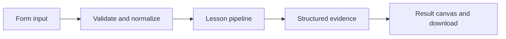

# How Turn notes into practice works

Build a grounded recall quiz from fact lines; optionally generate structured questions with a model.

## Why LangChain
LangChain supplies composable messages, prompts, model adapters, documents, or retrieval contracts. Pure local processing may be simpler without it; the lesson isolates the named engineering concept before introducing external services.

## Imports
`Path` resolves local configuration; `os` reads variable names; `json` encodes evidence; `time` measures local duration; `streamlit` renders the interface; `load_dotenv` loads optional configuration without replacing injected values. `ChatPromptTemplate` structures messages; `StrOutputParser` extracts text; `RunnableLambda` wraps Python functions; message classes represent chat roles; `ChatOpenAI` is used only by offered live paths. Additional concept-specific imports appear in the source below.

## Data flow


## Concept-specific implementation, annotated by source
Read this complete runnable core alongside app.py. Validation precedes processing; the returned dictionary defines what the UI displays.

```python
from pydantic import BaseModel, Field
class Question(BaseModel):
    question:str
    answer:str
class Quiz(BaseModel):
    questions:list[Question]=Field(min_length=1,max_length=10)

def run(data,live=False,model=None):
    text=require_text(data['facts'],6000)
    if live or model is not None:
        quiz=(model if model is not None else openai_model()).with_structured_output(Quiz).invoke('Create a recall quiz grounded only in these facts: '+text)
        items=[q.model_dump() for q in quiz.questions]
    else:
        rows=[line.split(':',1) for line in text.splitlines() if line.strip()]
        if not rows or len(rows)>10 or any(len(r)!=2 or not all(v.strip() for v in r) for r in rows): raise ValueError('Enter 1–10 lines in term: explanation format.')
        items=[{'question':'What is '+term.strip()+'?','answer':meaning.strip()} for term,meaning in rows]
    return {'questions':items,'count':len(items)}
```

## Important lines
- `def run(data,live=False,model=None):` — defines a callable stage and its input contract.
- `quiz=(model if model is not None else openai_model()).with_structured_output(Quiz).invoke('Create a recall quiz grounded only in these facts: '+text)` — executes the composed pipeline with the prepared input.
- `return {'questions':items,'count':len(items)}` — returns the observable result consumed by tests and the evidence canvas.

## Interface and reliability
The form submits related inputs together. Session state retains the last result; reset clears it. A spinner provides loading feedback. Input errors are shown in context; unknown provider errors are sanitized. Static HTML styles contain no user text. Every output carries explicit local/live labeling. The timer is not a provider latency benchmark. Local tests do not establish live provider correctness, visual browser quality, or production deployment.
