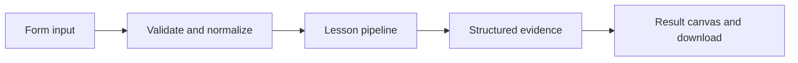

# How Structure from the start works

Validate contact JSON against a schema and compare it to optional model extraction.

## Why LangChain
LangChain supplies composable messages, prompts, model adapters, documents, or retrieval contracts. Pure local processing may be simpler without it; the lesson isolates the named engineering concept before introducing external services.

## Imports
`Path` resolves local configuration; `os` reads variable names; `json` encodes evidence; `time` measures local duration; `streamlit` renders the interface; `load_dotenv` loads optional configuration without replacing injected values. `ChatPromptTemplate` structures messages; `StrOutputParser` extracts text; `RunnableLambda` wraps Python functions; message classes represent chat roles; `ChatOpenAI` is used only by offered live paths. Additional concept-specific imports appear in the source below.

## Data flow


## Concept-specific implementation, annotated by source
Read this complete runnable core alongside app.py. Validation precedes processing; the returned dictionary defines what the UI displays.

```python
from pydantic import BaseModel, Field, ConfigDict
class Contact(BaseModel):
    model_config=ConfigDict(extra='forbid')
    name:str=Field(min_length=1,max_length=80)
    email:str=Field(pattern=r'^[^\s@]+@[^\s@]+\.[^\s@]+$')
    age:int=Field(ge=0,le=130,strict=True)

def run(data,live=False,model=None):
    text=require_text(data['text'],3000)
    contact=(model if model is not None else openai_model()).with_structured_output(Contact).invoke('Extract contact fields from: '+text) if live or model is not None else Contact.model_validate_json(text)
    return {'contact':contact.model_dump(),'schema_fields':sorted(Contact.model_fields)}
```

## Important lines
- `def run(data,live=False,model=None):` — defines a callable stage and its input contract.
- `contact=(model if model is not None else openai_model()).with_structured_output(Contact).invoke('Extract contact fields from: '+text) if live or model is not None else Contact.model_validate_json(text)` — executes the composed pipeline with the prepared input.
- `return {'contact':contact.model_dump(),'schema_fields':sorted(Contact.model_fields)}` — returns the observable result consumed by tests and the evidence canvas.

## Interface and reliability
The form submits related inputs together. Session state retains the last result; reset clears it. A spinner provides loading feedback. Input errors are shown in context; unknown provider errors are sanitized. Static HTML styles contain no user text. Every output carries explicit local/live labeling. The timer is not a provider latency benchmark. Local tests do not establish live provider correctness, visual browser quality, or production deployment.
