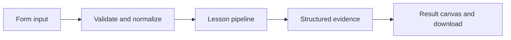

# How Answers in motion works

Watch chunks arrive from a generator; optional live mode uses the model streaming interface.

## Why LangChain
LangChain supplies composable messages, prompts, model adapters, documents, or retrieval contracts. Pure local processing may be simpler without it; the lesson isolates the named engineering concept before introducing external services.

## Imports
`Path` resolves local configuration; `os` reads variable names; `json` encodes evidence; `time` measures local duration; `streamlit` renders the interface; `load_dotenv` loads optional configuration without replacing injected values. `ChatPromptTemplate` structures messages; `StrOutputParser` extracts text; `RunnableLambda` wraps Python functions; message classes represent chat roles; `ChatOpenAI` is used only by offered live paths. Additional concept-specific imports appear in the source below.

## Data flow


## Concept-specific implementation, annotated by source
Read this complete runnable core alongside app.py. Validation precedes processing; the returned dictionary defines what the UI displays.

```python
def stream_answer(data,live=False,model=None):
    message=require_text(data['message'],2000)
    if live or model is not None:
        prompt=ChatPromptTemplate.from_messages([('system','Answer briefly.'),('human','{text}')])
        chain=prompt | (model if model is not None else openai_model()) | StrOutputParser()
        yield from chain.stream({'text':message})
    else:
        for word in ('Local streaming example: '+message).split():
            yield word+' '

def run(data,live=False,model=None):
    chunks=list(stream_answer(data,live,model))
    return {'answer':''.join(chunks),'chunks':chunks,'chunk_count':len(chunks)}
```

## Important lines
- `def stream_answer(data,live=False,model=None):` — defines a callable stage and its input contract.
- `def run(data,live=False,model=None):` — defines a callable stage and its input contract.
- `return {'answer':''.join(chunks),'chunks':chunks,'chunk_count':len(chunks)}` — returns the observable result consumed by tests and the evidence canvas.

## Interface and reliability
The form submits related inputs together. Session state retains the last result; reset clears it. A spinner provides loading feedback. Input errors are shown in context; unknown provider errors are sanitized. Static HTML styles contain no user text. Every output carries explicit local/live labeling. The timer is not a provider latency benchmark. Local tests do not establish live provider correctness, visual browser quality, or production deployment.
