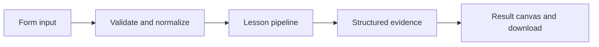

# How A conversation with continuity works

Keep role-based context across turns and trim the prompt to a bounded recent history.

## Why LangChain
LangChain supplies composable messages, prompts, model adapters, documents, or retrieval contracts. Pure local processing may be simpler without it; the lesson isolates the named engineering concept before introducing external services.

## Imports
`Path` resolves local configuration; `os` reads variable names; `json` encodes evidence; `time` measures local duration; `streamlit` renders the interface; `load_dotenv` loads optional configuration without replacing injected values. `ChatPromptTemplate` structures messages; `StrOutputParser` extracts text; `RunnableLambda` wraps Python functions; message classes represent chat roles; `ChatOpenAI` is used only by offered live paths. Additional concept-specific imports appear in the source below.

## Data flow


## Concept-specific implementation, annotated by source
Read this complete runnable core alongside app.py. Validation precedes processing; the returned dictionary defines what the UI displays.

```python
from langchain_core.messages import trim_messages
import re

def run(data,live=False,model=None):
    message=require_text(data['message'],2000);limit=int(data['max_messages']);history=data.get('history',[])
    if not 2<=limit<=20 or not isinstance(history,list) or len(history)>200: raise ValueError('Use 2–20 prompt messages and reset after 100 turns.')
    messages=[]
    for row in history:
        if row['role'] not in ('user','assistant'): raise ValueError('Invalid history role.')
        messages.append(HumanMessage(content=require_text(row['content'],4000)) if row['role']=='user' else AIMessage(content=require_text(row['content'],4000)))
    messages.append(HumanMessage(content=message))
    recent=trim_messages(messages,max_tokens=limit,token_counter=len,strategy='last',start_on='human',include_system=False)
    if live or model is not None: answer=(model if model is not None else openai_model()).invoke([SystemMessage(content='Use the conversation context. Be concise.')]+recent).content
    else:
        names=re.findall(r'my name is ([A-Za-z]+)',' '.join(str(m.content) for m in recent),re.I)
        answer='Local memory: '+(names[-1] if names else 'no name in retained context')
    updated=history+[{'role':'user','content':message},{'role':'assistant','content':answer}]
    return {'answer':answer,'history':updated,'prompt_messages':len(recent),'stored_messages':len(updated),'durability':'browser session only'}
```

## Important lines
- `def run(data,live=False,model=None):` — defines a callable stage and its input contract.
- `if live or model is not None: answer=(model if model is not None else openai_model()).invoke([SystemMessage(content='Use the conversation context. Be concise.')]+recent).content` — executes the composed pipeline with the prepared input.
- `return {'answer':answer,'history':updated,'prompt_messages':len(recent),'stored_messages':len(updated),'durability':'browser session only'}` — returns the observable result consumed by tests and the evidence canvas.

## Interface and reliability
The form submits related inputs together. Session state retains the last result; reset clears it. A spinner provides loading feedback. Input errors are shown in context; unknown provider errors are sanitized. Static HTML styles contain no user text. Every output carries explicit local/live labeling. The timer is not a provider latency benchmark. Local tests do not establish live provider correctness, visual browser quality, or production deployment.
