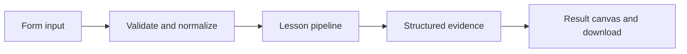

# How A tool call, made visible works

Inspect a model-style tool request, execute an allowlisted tool, and correlate its result by call ID.

## Why LangChain
LangChain supplies composable messages, prompts, model adapters, documents, or retrieval contracts. Pure local processing may be simpler without it; the lesson isolates the named engineering concept before introducing external services.

## Imports
`Path` resolves local configuration; `os` reads variable names; `json` encodes evidence; `time` measures local duration; `streamlit` renders the interface; `load_dotenv` loads optional configuration without replacing injected values. `ChatPromptTemplate` structures messages; `StrOutputParser` extracts text; `RunnableLambda` wraps Python functions; message classes represent chat roles; `ChatOpenAI` is used only by offered live paths. Additional concept-specific imports appear in the source below.

## Data flow


## Concept-specific implementation, annotated by source
Read this complete runnable core alongside app.py. Validation precedes processing; the returned dictionary defines what the UI displays.

```python
from langchain_core.tools import tool
from langchain_core.messages import ToolMessage
import re
@tool
def count_words(text:str)->int:
    """Count Unicode words in the supplied text."""
    return len(re.findall(r'\b\w+\b',text))

def run(data,live=False,model=None):
    text=require_text(data['text'],5000)
    if live or model is not None:
        response=(model if model is not None else openai_model()).bind_tools([count_words],tool_choice='count_words').invoke([HumanMessage(content='Count words in this text: '+text)])
    else:
        response=AIMessage(content='',tool_calls=[{'name':'count_words','args':{'text':text},'id':'call_local_1','type':'tool_call'}])
    outputs=[]
    for call in response.tool_calls:
        if call['name']!='count_words': raise ValueError('Unapproved tool request.')
        if call['args'].get('text')!=text: raise ValueError('Tool arguments must match the submitted text.')
        msg=count_words.invoke(call)
        outputs.append({'tool_call_id':msg.tool_call_id,'content':msg.content})
    if not outputs: raise ValueError('The model did not request a tool.')
    return {'calls':response.tool_calls,'tool_results':outputs,'word_count':int(outputs[0]['content'])}
```

## Important lines
- `def count_words(text:str)->int:` — defines a callable stage and its input contract.
- `return len(re.findall(r'\b\w+\b',text))` — returns the observable result consumed by tests and the evidence canvas.
- `def run(data,live=False,model=None):` — defines a callable stage and its input contract.
- `response=(model if model is not None else openai_model()).bind_tools([count_words],tool_choice='count_words').invoke([HumanMessage(content='Count words in this text: '+text)])` — executes the composed pipeline with the prepared input.
- `msg=count_words.invoke(call)` — executes the composed pipeline with the prepared input.
- `return {'calls':response.tool_calls,'tool_results':outputs,'word_count':int(outputs[0]['content'])}` — returns the observable result consumed by tests and the evidence canvas.

## Interface and reliability
The form submits related inputs together. Session state retains the last result; reset clears it. A spinner provides loading feedback. Input errors are shown in context; unknown provider errors are sanitized. Static HTML styles contain no user text. Every output carries explicit local/live labeling. The timer is not a provider latency benchmark. Local tests do not establish live provider correctness, visual browser quality, or production deployment.
