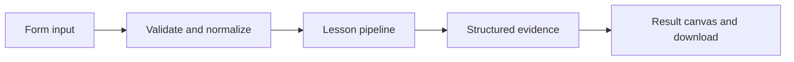

# How Let the agent calculate works

Run a real create_agent tool loop using restricted arithmetic and inspect every tool transition.

## Why LangChain
LangChain supplies composable messages, prompts, model adapters, documents, or retrieval contracts. Pure local processing may be simpler without it; the lesson isolates the named engineering concept before introducing external services.

## Imports
`Path` resolves local configuration; `os` reads variable names; `json` encodes evidence; `time` measures local duration; `streamlit` renders the interface; `load_dotenv` loads optional configuration without replacing injected values. `ChatPromptTemplate` structures messages; `StrOutputParser` extracts text; `RunnableLambda` wraps Python functions; message classes represent chat roles; `ChatOpenAI` is used only by offered live paths. Additional concept-specific imports appear in the source below.

## Data flow


## Concept-specific implementation, annotated by source
Read this complete runnable core alongside app.py. Validation precedes processing; the returned dictionary defines what the UI displays.

```python
import ast
import operator
from langchain_core.tools import tool
from langchain.agents import create_agent
from langchain_core.language_models.chat_models import BaseChatModel
from langchain_core.outputs import ChatGeneration, ChatResult
from langchain_core.messages import ToolMessage

@tool
def calculate(expression:str)->str:
    """Evaluate bounded arithmetic using +, -, *, /, and parentheses. No Python execution."""
    require_text(expression,200)
    tree=ast.parse(expression,mode='eval')
    if len(list(ast.walk(tree)))>50: raise ValueError('Expression too complex.')
    ops={ast.Add:operator.add,ast.Sub:operator.sub,ast.Mult:operator.mul,ast.Div:operator.truediv}
    def visit(node):
        if isinstance(node,ast.Expression): return visit(node.body)
        if isinstance(node,ast.Constant) and type(node.value) in (int,float): value=node.value
        elif isinstance(node,ast.UnaryOp) and isinstance(node.op,(ast.UAdd,ast.USub)): value=visit(node.operand)*(1 if isinstance(node.op,ast.UAdd) else -1)
        elif isinstance(node,ast.BinOp) and type(node.op) in ops:
            try: value=ops[type(node.op)](visit(node.left),visit(node.right))
            except ZeroDivisionError as exc: raise ValueError('Cannot divide by zero.') from exc
        else: raise ValueError('Only bounded arithmetic is permitted.')
        if not -1e12<=value<=1e12: raise ValueError('Magnitude exceeds safe lesson limit.')
        return value
    return str(visit(tree))

class LocalToolModel(BaseChatModel):
    expression:str
    @property
    def _llm_type(self): return 'deterministic-calculator-teaching-model'
    def bind_tools(self,tools,**kwargs): return self
    def _generate(self,messages,stop=None,run_manager=None,**kwargs):
        result=next((m for m in reversed(messages) if isinstance(m,ToolMessage)),None)
        msg=AIMessage(content=str(result.content)) if result else AIMessage(content='',tool_calls=[{'name':'calculate','args':{'expression':self.expression},'id':'arithmetic-1','type':'tool_call'}])
        return ChatResult(generations=[ChatGeneration(message=msg)])

def run(data,live=False,model=None):
    expression=require_text(data['expression'],200)
    # Validate before any model request, and never evaluate Python source.
    expected=calculate.invoke({'expression':expression})
    agent=create_agent(model=model if model is not None else openai_model() if live else LocalToolModel(expression=expression),tools=[calculate],system_prompt='Use calculate to evaluate the exact arithmetic expression. Return its result.')
    state=agent.invoke({'messages':[HumanMessage(content=expression)]},config={'recursion_limit':8})
    tools=[m for m in state['messages'] if isinstance(m,ToolMessage)]
    if not tools: raise ValueError('No calculator tool was executed.')
    return {'answer':state['messages'][-1].content,'numeric_result':expected,'tool_calls':len(tools),'messages':[{'role':m.type,'content':m.content} for m in state['messages']]}
```

## Important lines
- `def calculate(expression:str)->str:` — defines a callable stage and its input contract.
- `def visit(node):` — defines a callable stage and its input contract.
- `return value` — returns the observable result consumed by tests and the evidence canvas.
- `return str(visit(tree))` — returns the observable result consumed by tests and the evidence canvas.
- `def _llm_type(self): return 'deterministic-calculator-teaching-model'` — defines a callable stage and its input contract.
- `def bind_tools(self,tools,**kwargs): return self` — defines a callable stage and its input contract.
- `def _generate(self,messages,stop=None,run_manager=None,**kwargs):` — defines a callable stage and its input contract.
- `return ChatResult(generations=[ChatGeneration(message=msg)])` — returns the observable result consumed by tests and the evidence canvas.
- `def run(data,live=False,model=None):` — defines a callable stage and its input contract.
- `expected=calculate.invoke({'expression':expression})` — executes the composed pipeline with the prepared input.
- `state=agent.invoke({'messages':[HumanMessage(content=expression)]},config={'recursion_limit':8})` — executes the composed pipeline with the prepared input.
- `return {'answer':state['messages'][-1].content,'numeric_result':expected,'tool_calls':len(tools),'messages':[{'role':m.type,'content':m.content} for m in state['messages']]}` — returns the observable result consumed by tests and the evidence canvas.

## Interface and reliability
The form submits related inputs together. Session state retains the last result; reset clears it. A spinner provides loading feedback. Input errors are shown in context; unknown provider errors are sanitized. Static HTML styles contain no user text. Every output carries explicit local/live labeling. The timer is not a provider latency benchmark. Local tests do not establish live provider correctness, visual browser quality, or production deployment.
