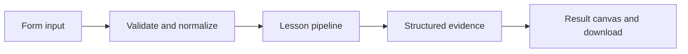

# How Split without losing the source works

Inspect recursive character chunks, overlap, and source metadata before indexing documents.

## Why LangChain
LangChain supplies composable messages, prompts, model adapters, documents, or retrieval contracts. Pure local processing may be simpler without it; the lesson isolates the named engineering concept before introducing external services.

## Imports
`Path` resolves local configuration; `os` reads variable names; `json` encodes evidence; `time` measures local duration; `streamlit` renders the interface; `load_dotenv` loads optional configuration without replacing injected values. `ChatPromptTemplate` structures messages; `StrOutputParser` extracts text; `RunnableLambda` wraps Python functions; message classes represent chat roles; `ChatOpenAI` is used only by offered live paths. Additional concept-specific imports appear in the source below.

## Data flow


## Concept-specific implementation, annotated by source
Read this complete runnable core alongside app.py. Validation precedes processing; the returned dictionary defines what the UI displays.

```python
from langchain_core.documents import Document
from langchain_text_splitters import RecursiveCharacterTextSplitter

def run(data,live=False,model=None):
    text=require_text(data['text']);size=int(data['size']);overlap=int(data['overlap'])
    if not 10<=size<=500 or not 0<=overlap<size: raise ValueError('Use chunk size 10–500 and overlap smaller than size.')
    splitter=RecursiveCharacterTextSplitter(chunk_size=size,chunk_overlap=overlap,add_start_index=True)
    chunks=splitter.split_documents([Document(page_content=text,metadata={'source':'input'})])
    return {'chunks':[{'text':d.page_content,'start':d.metadata['start_index'],'source':d.metadata['source']} for d in chunks],'count':len(chunks),'max_length':max(len(d.page_content) for d in chunks)}
```

## Important lines
- `def run(data,live=False,model=None):` — defines a callable stage and its input contract.
- `return {'chunks':[{'text':d.page_content,'start':d.metadata['start_index'],'source':d.metadata['source']} for d in chunks],'count':len(chunks),'max_length':max(len(d.page_content) for d in chunks)}` — returns the observable result consumed by tests and the evidence canvas.

## Interface and reliability
The form submits related inputs together. Session state retains the last result; reset clears it. A spinner provides loading feedback. Input errors are shown in context; unknown provider errors are sanitized. Static HTML styles contain no user text. Every output carries explicit local/live labeling. The timer is not a provider latency benchmark. Local tests do not establish live provider correctness, visual browser quality, or production deployment.
