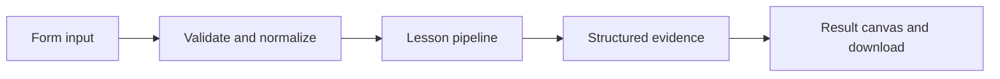

# How A map of words works

Explore vector dimensions and cosine similarity with transparent local lexical hashing or optional OpenAI embeddings.

## Why LangChain
LangChain supplies composable messages, prompts, model adapters, documents, or retrieval contracts. Pure local processing may be simpler without it; the lesson isolates the named engineering concept before introducing external services.

## Imports
`Path` resolves local configuration; `os` reads variable names; `json` encodes evidence; `time` measures local duration; `streamlit` renders the interface; `load_dotenv` loads optional configuration without replacing injected values. `ChatPromptTemplate` structures messages; `StrOutputParser` extracts text; `RunnableLambda` wraps Python functions; message classes represent chat roles; `ChatOpenAI` is used only by offered live paths. Additional concept-specific imports appear in the source below.

## Data flow


## Concept-specific implementation, annotated by source
Read this complete runnable core alongside app.py. Validation precedes processing; the returned dictionary defines what the UI displays.

```python
import hashlib
import math
import re
from langchain_core.embeddings import Embeddings
class LocalHashEmbeddings(Embeddings):
    """Deterministic lexical hashing, NOT semantic embeddings."""
    def embed_query(self,text):
        vector=[0.0]*64
        for token in re.findall(r'\w+',text.casefold()):
            index=int.from_bytes(hashlib.sha256(token.encode()).digest()[:4],'big')%64
            vector[index]+=1
        norm=math.sqrt(sum(x*x for x in vector))
        return [x/norm for x in vector] if norm else vector
    def embed_documents(self,texts): return [self.embed_query(t) for t in texts]

def run(data,live=False,model=None):
    text=require_text(data['text'],2000);other=require_text(data['other'],2000)
    if live:
        openai_model() # Validate key before constructing the embeddings client.
        from langchain_openai import OpenAIEmbeddings
        embedding=OpenAIEmbeddings(model='text-embedding-3-small',request_timeout=30,max_retries=1)
    else: embedding=LocalHashEmbeddings()
    vectors=embedding.embed_documents([text,other]);a,b=vectors
    denominator=math.sqrt(sum(v*v for v in a)*sum(v*v for v in b))
    similarity=sum(x*y for x,y in zip(a,b))/denominator if denominator else 0
    return {'dimensions':len(a),'cosine_similarity':round(similarity,6),'vector_preview':a[:8],'method':'OpenAI semantic embeddings' if live else 'local lexical hashing; collisions possible'}
```

## Important lines
- `def embed_query(self,text):` — defines a callable stage and its input contract.
- `return [x/norm for x in vector] if norm else vector` — returns the observable result consumed by tests and the evidence canvas.
- `def embed_documents(self,texts): return [self.embed_query(t) for t in texts]` — defines a callable stage and its input contract.
- `def run(data,live=False,model=None):` — defines a callable stage and its input contract.
- `return {'dimensions':len(a),'cosine_similarity':round(similarity,6),'vector_preview':a[:8],'method':'OpenAI semantic embeddings' if live else 'local lexical hashing; collisions possible'}` — returns the observable result consumed by tests and the evidence canvas.

## Interface and reliability
The form submits related inputs together. Session state retains the last result; reset clears it. A spinner provides loading feedback. Input errors are shown in context; unknown provider errors are sanitized. Static HTML styles contain no user text. Every output carries explicit local/live labeling. The timer is not a provider latency benchmark. Local tests do not establish live provider correctness, visual browser quality, or production deployment.
