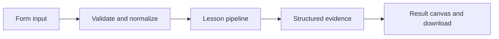

# How Answers with receipts works

Retrieve documents, expose the evidence, and produce a cited answer or an explicit abstention.

## Why LangChain
LangChain supplies composable messages, prompts, model adapters, documents, or retrieval contracts. Pure local processing may be simpler without it; the lesson isolates the named engineering concept before introducing external services.

## Imports
`Path` resolves local configuration; `os` reads variable names; `json` encodes evidence; `time` measures local duration; `streamlit` renders the interface; `load_dotenv` loads optional configuration without replacing injected values. `ChatPromptTemplate` structures messages; `StrOutputParser` extracts text; `RunnableLambda` wraps Python functions; message classes represent chat roles; `ChatOpenAI` is used only by offered live paths. Additional concept-specific imports appear in the source below.

## Data flow


## Concept-specific implementation, annotated by source
Read this complete runnable core alongside app.py. Validation precedes processing; the returned dictionary defines what the UI displays.

```python
import hashlib
import math
import re
from langchain_core.embeddings import Embeddings
class LocalHashEmbeddings(Embeddings):
    """Deterministic lexical hashing, NOT semantic embeddings."""
    def embed_query(self,text):
        vector=[0.0]*64
        for token in re.findall(r'\w+',text.casefold()):
            index=int.from_bytes(hashlib.sha256(token.encode()).digest()[:4],'big')%64
            vector[index]+=1
        norm=math.sqrt(sum(x*x for x in vector))
        return [x/norm for x in vector] if norm else vector
    def embed_documents(self,texts): return [self.embed_query(t) for t in texts]

from langchain_core.documents import Document
from langchain_core.vectorstores import InMemoryVectorStore

def retrieve(data):
    question=require_text(data['question'],2000)
    raw=data['documents'];rows=json.loads(raw) if isinstance(raw,str) else raw
    if not isinstance(rows,list) or not 1<=len(rows)<=50: raise ValueError('Supply a JSON array of 1–50 documents.')
    docs=[Document(page_content=require_text(text,4000),metadata={'source':f'doc-{i+1}'}) for i,text in enumerate(rows)]
    store=InMemoryVectorStore(LocalHashEmbeddings());store.add_documents(docs)
    if not any(LocalHashEmbeddings().embed_query(question)): return question,[]
    matches=store.similarity_search_with_score(question,k=min(3,len(docs)))
    return question,[{'source':d.metadata['source'],'text':d.page_content,'score':round(float(score),6)} for d,score in matches if float(score)>0]

def run(data,live=False,model=None):
    question,matches=retrieve(data)
    if not matches: answer='No matching evidence. I do not know.'
    elif live or model is not None:
        context='\n'.join('['+m['source']+'] '+m['text'] for m in matches)
        answer=ask('Answer only from the supplied evidence. Cite source IDs in brackets. If unsupported, say you do not know.', 'Question: '+question+'\nEvidence:\n'+context,model)
    else: answer=' '.join('['+m['source']+'] '+m['text'] for m in matches)
    return {'answer':answer,'evidence':matches,'sources':[m['source'] for m in matches],'method':'model grounded in retrieved context' if live or model is not None else 'extractive evidence answer'}
```

## Important lines
- `def embed_query(self,text):` — defines a callable stage and its input contract.
- `return [x/norm for x in vector] if norm else vector` — returns the observable result consumed by tests and the evidence canvas.
- `def embed_documents(self,texts): return [self.embed_query(t) for t in texts]` — defines a callable stage and its input contract.
- `def retrieve(data):` — defines a callable stage and its input contract.
- `return question,[{'source':d.metadata['source'],'text':d.page_content,'score':round(float(score),6)} for d,score in matches if float(score)>0]` — returns the observable result consumed by tests and the evidence canvas.
- `def run(data,live=False,model=None):` — defines a callable stage and its input contract.
- `return {'answer':answer,'evidence':matches,'sources':[m['source'] for m in matches],'method':'model grounded in retrieved context' if live or model is not None else 'extractive evidence answer'}` — returns the observable result consumed by tests and the evidence canvas.

## Interface and reliability
The form submits related inputs together. Session state retains the last result; reset clears it. A spinner provides loading feedback. Input errors are shown in context; unknown provider errors are sanitized. Static HTML styles contain no user text. Every output carries explicit local/live labeling. The timer is not a provider latency benchmark. Local tests do not establish live provider correctness, visual browser quality, or production deployment.
