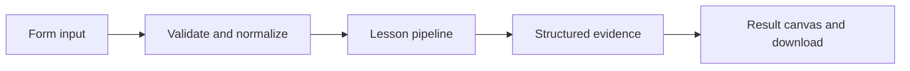

# How Follow the trace works

Instrument nested LangSmith traceable stages and inspect redacted local timing evidence without a cloud account.

## Why LangChain
LangChain supplies composable messages, prompts, model adapters, documents, or retrieval contracts. Pure local processing may be simpler without it; the lesson isolates the named engineering concept before introducing external services.

## Imports
`Path` resolves local configuration; `os` reads variable names; `json` encodes evidence; `time` measures local duration; `streamlit` renders the interface; `load_dotenv` loads optional configuration without replacing injected values. `ChatPromptTemplate` structures messages; `StrOutputParser` extracts text; `RunnableLambda` wraps Python functions; message classes represent chat roles; `ChatOpenAI` is used only by offered live paths. Additional concept-specific imports appear in the source below.

## Data flow


## Concept-specific implementation, annotated by source
Read this complete runnable core alongside app.py. Validation precedes processing; the returned dictionary defines what the UI displays.

```python
from langsmith import traceable, tracing_context
import uuid
@traceable(name='normalize',run_type='chain',process_inputs=lambda _: {'input':'[redacted]'},process_outputs=lambda _: {'output':'[redacted]'})
def normalize(text): return ' '.join(text.split())
@traceable(name='analyze',run_type='chain',process_inputs=lambda _: {'input':'[redacted]'})
def analyze(text): return {'characters':len(text),'words':len(text.split())}
@traceable(name='learning-pipeline',run_type='chain',process_inputs=lambda _: {'input':'[redacted]'})
def traced_pipeline(text): return analyze(normalize(text))

def run(data,live=False,model=None):
    text=require_text(data['text'],5000)
    if live:
        key=os.getenv('LANGSMITH_API_KEY','').strip()
        if not key or key=='YOUR_LANGSMITH_API_KEY_HERE': raise ValueError('Set LANGSMITH_API_KEY to export traces.')
    started=time.perf_counter()
    with tracing_context(enabled=live,project_name=os.getenv('LANGSMITH_PROJECT','langchain-learning')):
        result=traced_pipeline(text)
    return {**result,'local_operation_id':str(uuid.uuid4()),'duration_ms':round((time.perf_counter()-started)*1000,3),'trace_structure':['learning-pipeline','normalize','analyze'],'export_requested':live,'cloud_delivery_verified':False,'privacy':'input/output text redacted in decorators; local operation ID is not a LangSmith run ID'}
```

## Important lines
- `def normalize(text): return ' '.join(text.split())` — defines a callable stage and its input contract.
- `def analyze(text): return {'characters':len(text),'words':len(text.split())}` — defines a callable stage and its input contract.
- `def traced_pipeline(text): return analyze(normalize(text))` — defines a callable stage and its input contract.
- `def run(data,live=False,model=None):` — defines a callable stage and its input contract.
- `return {**result,'local_operation_id':str(uuid.uuid4()),'duration_ms':round((time.perf_counter()-started)*1000,3),'trace_structure':['learning-pipeline','normalize','analyze'],'export_requested':live,'cloud_delivery_verified':False,'privacy':'input/output text redacted in decorators; local operation ID is not a LangSmith run ID'}` — returns the observable result consumed by tests and the evidence canvas.

## Interface and reliability
The form submits related inputs together. Session state retains the last result; reset clears it. A spinner provides loading feedback. Input errors are shown in context; unknown provider errors are sanitized. Static HTML styles contain no user text. Every output carries explicit local/live labeling. The timer is not a provider latency benchmark. Local tests do not establish live provider correctness, visual browser quality, or production deployment.
