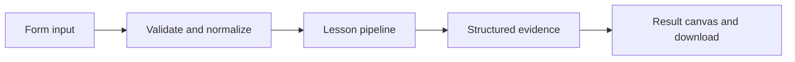

# How Memory that survives a restart works

Store user preferences in SQLite with namespaced keys, parameterized queries, and explicit read/write actions.

## Why LangChain
LangChain supplies composable messages, prompts, model adapters, documents, or retrieval contracts. Pure local processing may be simpler without it; the lesson isolates the named engineering concept before introducing external services.

## Imports
`Path` resolves local configuration; `os` reads variable names; `json` encodes evidence; `time` measures local duration; `streamlit` renders the interface; `load_dotenv` loads optional configuration without replacing injected values. `ChatPromptTemplate` structures messages; `StrOutputParser` extracts text; `RunnableLambda` wraps Python functions; message classes represent chat roles; `ChatOpenAI` is used only by offered live paths. Additional concept-specific imports appear in the source below.

## Data flow


## Concept-specific implementation, annotated by source
Read this complete runnable core alongside app.py. Validation precedes processing; the returned dictionary defines what the UI displays.

```python
import sqlite3
DATA_DIR=Path(__file__).with_name('.local')
def run(data,live=False,model=None):
    user=require_text(data['user'],80);action=data['action']
    if action not in ('save','load'): raise ValueError('Choose save or load.')
    value=require_text(data['value'],2000) if action=='save' else None
    DATA_DIR.mkdir(exist_ok=True,parents=True)
    with sqlite3.connect(DATA_DIR/'memory.sqlite') as db:
        db.execute('CREATE TABLE IF NOT EXISTS preferences(user TEXT PRIMARY KEY,value TEXT NOT NULL)')
        if action=='save': db.execute('INSERT INTO preferences VALUES (?,?) ON CONFLICT(user) DO UPDATE SET value=excluded.value',(user,value))
        row=db.execute('SELECT value FROM preferences WHERE user=?',(user,)).fetchone()
    return {'user':user,'value':row[0] if row else None,'found':bool(row),'durability':'local SQLite file; protect and back it up; no authentication implied'}
```

## Important lines
- `def run(data,live=False,model=None):` — defines a callable stage and its input contract.
- `return {'user':user,'value':row[0] if row else None,'found':bool(row),'durability':'local SQLite file; protect and back it up; no authentication implied'}` — returns the observable result consumed by tests and the evidence canvas.

## Interface and reliability
The form submits related inputs together. Session state retains the last result; reset clears it. A spinner provides loading feedback. Input errors are shown in context; unknown provider errors are sanitized. Static HTML styles contain no user text. Every output carries explicit local/live labeling. The timer is not a provider latency benchmark. Local tests do not establish live provider correctness, visual browser quality, or production deployment.
