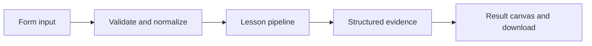

# How State on the graph works

Build a typed LangGraph with two nodes and inspect how each stage updates shared state.

## Why LangChain
LangChain supplies composable messages, prompts, model adapters, documents, or retrieval contracts. Pure local processing may be simpler without it; the lesson isolates the named engineering concept before introducing external services.

## Imports
`Path` resolves local configuration; `os` reads variable names; `json` encodes evidence; `time` measures local duration; `streamlit` renders the interface; `load_dotenv` loads optional configuration without replacing injected values. `ChatPromptTemplate` structures messages; `StrOutputParser` extracts text; `RunnableLambda` wraps Python functions; message classes represent chat roles; `ChatOpenAI` is used only by offered live paths. Additional concept-specific imports appear in the source below.

## Data flow


## Concept-specific implementation, annotated by source
Read this complete runnable core alongside app.py. Validation precedes processing; the returned dictionary defines what the UI displays.

```python
from typing_extensions import TypedDict
from langgraph.graph import StateGraph, START, END

class State(TypedDict):
    text:str
    normalized:str
    words:int

def build_graph():
    graph=StateGraph(State)
    graph.add_node('normalize',lambda s:{'normalized':' '.join(s['text'].split())})
    graph.add_node('count',lambda s:{'words':len(s['normalized'].split())})
    graph.add_edge(START,'normalize');graph.add_edge('normalize','count');graph.add_edge('count',END)
    return graph.compile()

def run(data,live=False,model=None):
    text=require_text(data['text'],4000)
    return dict(build_graph().invoke({'text':text}))
```

## Important lines
- `def build_graph():` — defines a callable stage and its input contract.
- `return graph.compile()` — returns the observable result consumed by tests and the evidence canvas.
- `def run(data,live=False,model=None):` — defines a callable stage and its input contract.
- `return dict(build_graph().invoke({'text':text}))` — returns the observable result consumed by tests and the evidence canvas.

## Interface and reliability
The form submits related inputs together. Session state retains the last result; reset clears it. A spinner provides loading feedback. Input errors are shown in context; unknown provider errors are sanitized. Static HTML styles contain no user text. Every output carries explicit local/live labeling. The timer is not a provider latency benchmark. Local tests do not establish live provider correctness, visual browser quality, or production deployment.
