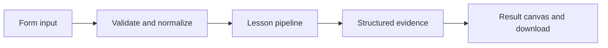

# How Pause before the action works

Persist a graph interrupt and resume the same thread only after an explicit approval decision.

## Why LangChain
LangChain supplies composable messages, prompts, model adapters, documents, or retrieval contracts. Pure local processing may be simpler without it; the lesson isolates the named engineering concept before introducing external services.

## Imports
`Path` resolves local configuration; `os` reads variable names; `json` encodes evidence; `time` measures local duration; `streamlit` renders the interface; `load_dotenv` loads optional configuration without replacing injected values. `ChatPromptTemplate` structures messages; `StrOutputParser` extracts text; `RunnableLambda` wraps Python functions; message classes represent chat roles; `ChatOpenAI` is used only by offered live paths. Additional concept-specific imports appear in the source below.

## Data flow


## Concept-specific implementation, annotated by source
Read this complete runnable core alongside app.py. Validation precedes processing; the returned dictionary defines what the UI displays.

```python
from typing_extensions import TypedDict
from langgraph.graph import StateGraph, START, END

from langgraph.types import interrupt, Command
from langgraph.checkpoint.sqlite import SqliteSaver
DATA_DIR=Path(__file__).with_name('.local')
class ApprovalState(TypedDict):
    request:str
    decision:str
    executed:bool

def review(state):
    decision=interrupt({'proposed_action':state['request'],'message':'Approve or reject this local demonstration.'})
    return {'decision':decision,'executed':decision=='approve'}

def run(data,live=False,model=None):
    thread=require_text(data['thread'],80);action=data['action'];request=require_text(data['request'],2000)
    if action not in ('pause','approve','reject'): raise ValueError('Invalid approval action.')
    DATA_DIR.mkdir(parents=True,exist_ok=True)
    with SqliteSaver.from_conn_string(str(DATA_DIR/'checkpoints.sqlite')) as saver:
        graph=StateGraph(ApprovalState);graph.add_node('review',review);graph.add_edge(START,'review');graph.add_edge('review',END)
        compiled=graph.compile(checkpointer=saver);config={'configurable':{'thread_id':thread}}
        snapshot=compiled.get_state(config)
        if action=='pause':
            if snapshot.next: raise ValueError('This thread is already waiting. Approve/reject it, or choose a new thread ID.')
            result=compiled.invoke({'request':request,'decision':'pending','executed':False},config)
        else:
            if not snapshot.next: raise ValueError('Pause a request on this thread before resuming.')
            result=compiled.invoke(Command(resume=action),config)
        return {'thread':thread,'pending':bool(result.get('__interrupt__')),'decision':result['decision'],'executed':result['executed'],'request':result['request'],'effect':'local state transition only; no external message sent'}
```

## Important lines
- `def review(state):` — defines a callable stage and its input contract.
- `return {'decision':decision,'executed':decision=='approve'}` — returns the observable result consumed by tests and the evidence canvas.
- `def run(data,live=False,model=None):` — defines a callable stage and its input contract.
- `result=compiled.invoke({'request':request,'decision':'pending','executed':False},config)` — executes the composed pipeline with the prepared input.
- `result=compiled.invoke(Command(resume=action),config)` — executes the composed pipeline with the prepared input.
- `return {'thread':thread,'pending':bool(result.get('__interrupt__')),'decision':result['decision'],'executed':result['executed'],'request':result['request'],'effect':'local state transition only; no external message sent'}` — returns the observable result consumed by tests and the evidence canvas.

## Interface and reliability
The form submits related inputs together. Session state retains the last result; reset clears it. A spinner provides loading feedback. Input errors are shown in context; unknown provider errors are sanitized. Static HTML styles contain no user text. Every output carries explicit local/live labeling. The timer is not a provider latency benchmark. Local tests do not establish live provider correctness, visual browser quality, or production deployment.
