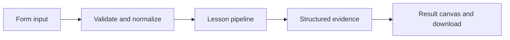

# How A PDF, grounded in evidence works

Extract an uploaded PDF page by page, then retrieve source-labeled passages for a question. The built-in example uses text pages.

## Why LangChain
LangChain supplies composable messages, prompts, model adapters, documents, or retrieval contracts. Pure local processing may be simpler without it; the lesson isolates the named engineering concept before introducing external services.

## Imports
`Path` resolves local configuration; `os` reads variable names; `json` encodes evidence; `time` measures local duration; `streamlit` renders the interface; `load_dotenv` loads optional configuration without replacing injected values. `ChatPromptTemplate` structures messages; `StrOutputParser` extracts text; `RunnableLambda` wraps Python functions; message classes represent chat roles; `ChatOpenAI` is used only by offered live paths. Additional concept-specific imports appear in the source below.

## Data flow


## Concept-specific implementation, annotated by source
Read this complete runnable core alongside app.py. Validation precedes processing; the returned dictionary defines what the UI displays.

```python
import hashlib
import math
import re
from langchain_core.embeddings import Embeddings
class LocalHashEmbeddings(Embeddings):
    """Deterministic lexical hashing, NOT semantic embeddings."""
    def embed_query(self,text):
        vector=[0.0]*64
        for token in re.findall(r'\w+',text.casefold()):
            index=int.from_bytes(hashlib.sha256(token.encode()).digest()[:4],'big')%64
            vector[index]+=1
        norm=math.sqrt(sum(x*x for x in vector))
        return [x/norm for x in vector] if norm else vector
    def embed_documents(self,texts): return [self.embed_query(t) for t in texts]

from langchain_core.documents import Document
from langchain_core.vectorstores import InMemoryVectorStore

def retrieve(data):
    question=require_text(data['question'],2000)
    raw=data['documents'];rows=json.loads(raw) if isinstance(raw,str) else raw
    if not isinstance(rows,list) or not 1<=len(rows)<=50: raise ValueError('Supply a JSON array of 1–50 documents.')
    docs=[Document(page_content=require_text(text,4000),metadata={'source':f'doc-{i+1}'}) for i,text in enumerate(rows)]
    store=InMemoryVectorStore(LocalHashEmbeddings());store.add_documents(docs)
    if not any(LocalHashEmbeddings().embed_query(question)): return question,[]
    matches=store.similarity_search_with_score(question,k=min(3,len(docs)))
    return question,[{'source':d.metadata['source'],'text':d.page_content,'score':round(float(score),6)} for d,score in matches if float(score)>0]

import io
from pypdf import PdfReader

def extract_pages(content):
    if len(content)>5_000_000: raise ValueError('PDF must be below 5 MB.')
    try:
        pdf=PdfReader(io.BytesIO(content))
        if pdf.is_encrypted: raise ValueError('Encrypted PDF is not supported.')
        if len(pdf.pages)>50: raise ValueError('Use at most 50 pages.')
        pages=[page.extract_text() or '' for page in pdf.pages]
    except Exception as exc: raise ValueError('Cannot read this PDF; use a valid unencrypted text PDF.') from exc
    if not any(p.strip() for p in pages): raise ValueError('No extractable text. Scanned PDFs require OCR, which this lesson does not provide.')
    return pages

def run(data,live=False,model=None):
    from langchain_text_splitters import RecursiveCharacterTextSplitter
    question=require_text(data['question'],2000)
    raw=extract_pages(data['pdf_bytes']) if data.get('pdf_bytes') else data['pages']
    pages=json.loads(raw) if isinstance(raw,str) else raw
    if not isinstance(pages,list) or not 1<=len(pages)<=50:raise ValueError('Supply 1–50 text pages.')
    documents=[]
    for index,text in enumerate(pages,1):
        if not isinstance(text,str):raise ValueError('Each page must be text.')
        if len(text)>100000:raise ValueError('Page text exceeds 100,000 characters.')
        if text.strip():documents.append(Document(page_content=text,metadata={'page':index}))
    if not documents:raise ValueError('No extractable text pages.')
    splitter=RecursiveCharacterTextSplitter(chunk_size=1000,chunk_overlap=100,add_start_index=True)
    chunks=splitter.split_documents(documents)
    if len(chunks)>500:raise ValueError('Use a smaller PDF (at most 500 chunks).')
    evidence=[]
    if any(LocalHashEmbeddings().embed_query(question)):
        store=InMemoryVectorStore(LocalHashEmbeddings());store.add_documents(chunks)
        for document,score in store.similarity_search_with_score(question,k=min(3,len(chunks))):
            if score>0:evidence.append({'page':document.metadata['page'],'start':document.metadata['start_index'],'text':document.page_content,'score':round(float(score),6)})
    return {'answer':' '.join('[page-'+str(m['page'])+'] '+m['text'] for m in evidence) if evidence else 'No matching page evidence.','evidence':evidence,'matches':len(evidence),'ocr':False,'pages':len(pages),'chunks':len(chunks)}
```

## Important lines
- `def embed_query(self,text):` — defines a callable stage and its input contract.
- `return [x/norm for x in vector] if norm else vector` — returns the observable result consumed by tests and the evidence canvas.
- `def embed_documents(self,texts): return [self.embed_query(t) for t in texts]` — defines a callable stage and its input contract.
- `def retrieve(data):` — defines a callable stage and its input contract.
- `return question,[{'source':d.metadata['source'],'text':d.page_content,'score':round(float(score),6)} for d,score in matches if float(score)>0]` — returns the observable result consumed by tests and the evidence canvas.
- `def extract_pages(content):` — defines a callable stage and its input contract.
- `return pages` — returns the observable result consumed by tests and the evidence canvas.
- `def run(data,live=False,model=None):` — defines a callable stage and its input contract.
- `return {'answer':' '.join('[page-'+m['source'].split('-')[-1]+'] '+m['text'] for m in matches) if matches else 'No matching page evidence.','evidence':matches,'matches':len(matches),'ocr':False}` — returns the observable result consumed by tests and the evidence canvas.

## Interface and reliability
The form submits related inputs together. Session state retains the last result; reset clears it. A spinner provides loading feedback. Input errors are shown in context; unknown provider errors are sanitized. Static HTML styles contain no user text. Every output carries explicit local/live labeling. The timer is not a provider latency benchmark. Local tests do not establish live provider correctness, visual browser quality, or production deployment.
