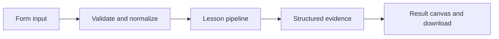

# How Plan with Deep Agents works

Run a Deep Agent with its built-in planning tool and inspect the resulting todo state.

## Why LangChain
LangChain supplies composable messages, prompts, model adapters, documents, or retrieval contracts. Pure local processing may be simpler without it; the lesson isolates the named engineering concept before introducing external services.

## Imports
`Path` resolves local configuration; `os` reads variable names; `json` encodes evidence; `time` measures local duration; `streamlit` renders the interface; `load_dotenv` loads optional configuration without replacing injected values. `ChatPromptTemplate` structures messages; `StrOutputParser` extracts text; `RunnableLambda` wraps Python functions; message classes represent chat roles; `ChatOpenAI` is used only by offered live paths. Additional concept-specific imports appear in the source below.

## Data flow


## Concept-specific implementation, annotated by source
Read this complete runnable core alongside app.py. Validation precedes processing; the returned dictionary defines what the UI displays.

```python
from langchain.agents import create_agent
from langchain_core.language_models.chat_models import BaseChatModel
from langchain_core.outputs import ChatGeneration, ChatResult
from langchain_core.messages import ToolMessage
from langchain_core.tools import tool
class ScriptedChatModel(BaseChatModel):
    """Deterministic tool protocol fixture, not an intelligent model."""
    script:list[dict]=[]
    final:str='Local agent complete.'
    @property
    def _llm_type(self): return 'scripted-teaching-model'
    def bind_tools(self,tools,**kwargs): return self
    def _generate(self,messages,stop=None,run_manager=None,**kwargs):
        n=sum(isinstance(m,ToolMessage) for m in messages)
        message=AIMessage(content='',tool_calls=[{**self.script[n],'id':f'call-{n}','type':'tool_call'}]) if n<len(self.script) else AIMessage(content=self.final)
        return ChatResult(generations=[ChatGeneration(message=message)])

def agent_result(agent,text):
    result=agent.invoke({'messages':[HumanMessage(content=text)]},config={'recursion_limit':20})
    return {'answer':result['messages'][-1].content,'tool_calls':sum(isinstance(m,ToolMessage) for m in result['messages']),'messages':[{'role':m.type,'content':m.content} for m in result['messages']]}

from deepagents import create_deep_agent

def run(data,live=False,model=None):
    task=require_text(data['task'],2000)
    fixture=ScriptedChatModel(script=[{'name':'write_todos','args':{'todos':[{'content':task,'status':'in_progress'}]}}],final='Plan recorded. Local fixture does not perform research.')
    agent=create_deep_agent(model=model if model is not None else openai_model() if live else fixture,system_prompt='Plan the task with write_todos. Do not execute shell commands.')
    result=agent.invoke({'messages':[HumanMessage(content=task)]},config={'recursion_limit':12})
    return {'answer':result['messages'][-1].content,'todos':result.get('todos',[]),'todo_count':len(result.get('todos',[])),'backend':'default state-backed virtual filesystem; no OS shell execution'}
```

## Important lines
- `def _llm_type(self): return 'scripted-teaching-model'` — defines a callable stage and its input contract.
- `def bind_tools(self,tools,**kwargs): return self` — defines a callable stage and its input contract.
- `def _generate(self,messages,stop=None,run_manager=None,**kwargs):` — defines a callable stage and its input contract.
- `return ChatResult(generations=[ChatGeneration(message=message)])` — returns the observable result consumed by tests and the evidence canvas.
- `def agent_result(agent,text):` — defines a callable stage and its input contract.
- `result=agent.invoke({'messages':[HumanMessage(content=text)]},config={'recursion_limit':20})` — executes the composed pipeline with the prepared input.
- `return {'answer':result['messages'][-1].content,'tool_calls':sum(isinstance(m,ToolMessage) for m in result['messages']),'messages':[{'role':m.type,'content':m.content} for m in result['messages']]}` — returns the observable result consumed by tests and the evidence canvas.
- `def run(data,live=False,model=None):` — defines a callable stage and its input contract.
- `result=agent.invoke({'messages':[HumanMessage(content=task)]},config={'recursion_limit':12})` — executes the composed pipeline with the prepared input.
- `return {'answer':result['messages'][-1].content,'todos':result.get('todos',[]),'todo_count':len(result.get('todos',[])),'backend':'default state-backed virtual filesystem; no OS shell execution'}` — returns the observable result consumed by tests and the evidence canvas.

## Interface and reliability
The form submits related inputs together. Session state retains the last result; reset clears it. A spinner provides loading feedback. Input errors are shown in context; unknown provider errors are sanitized. Static HTML styles contain no user text. Every output carries explicit local/live labeling. The timer is not a provider latency benchmark. Local tests do not establish live provider correctness, visual browser quality, or production deployment.
