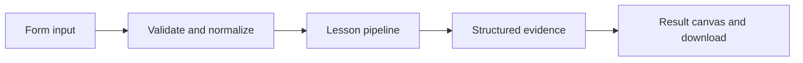

# How Instructions have a home works

Load an allowlisted AGENTS.md and SKILL.md, validate skill frontmatter, and compose a context preview.

## Why LangChain
LangChain supplies composable messages, prompts, model adapters, documents, or retrieval contracts. Pure local processing may be simpler without it; the lesson isolates the named engineering concept before introducing external services.

## Imports
`Path` resolves local configuration; `os` reads variable names; `json` encodes evidence; `time` measures local duration; `streamlit` renders the interface; `load_dotenv` loads optional configuration without replacing injected values. `ChatPromptTemplate` structures messages; `StrOutputParser` extracts text; `RunnableLambda` wraps Python functions; message classes represent chat roles; `ChatOpenAI` is used only by offered live paths. Additional concept-specific imports appear in the source below.

## Data flow


## Concept-specific implementation, annotated by source
Read this complete runnable core alongside app.py. Validation precedes processing; the returned dictionary defines what the UI displays.

```python
def run(data,live=False,model=None):
    task=require_text(data['task'],2000)
    agents=Path(__file__).with_name('AGENTS.md').read_text()
    skill=Path(__file__).with_name('skills').joinpath('review','SKILL.md').read_text()
    if not skill.startswith('---\n') or 'name: review' not in skill.split('---',2)[1]: raise ValueError('Skill metadata is invalid.')
    return {'answer':agents+'\nSelected skill:\n'+skill+'\nTask (untrusted input):\n'+task,'skill':'review','files':['AGENTS.md','skills/review/SKILL.md'],'automatic_discovery':False}
```

## Important lines
- `def run(data,live=False,model=None):` — defines a callable stage and its input contract.
- `return {'answer':agents+'\nSelected skill:\n'+skill+'\nTask (untrusted input):\n'+task,'skill':'review','files':['AGENTS.md','skills/review/SKILL.md'],'automatic_discovery':False}` — returns the observable result consumed by tests and the evidence canvas.

## Interface and reliability
The form submits related inputs together. Session state retains the last result; reset clears it. A spinner provides loading feedback. Input errors are shown in context; unknown provider errors are sanitized. Static HTML styles contain no user text. Every output carries explicit local/live labeling. The timer is not a provider latency benchmark. Local tests do not establish live provider correctness, visual browser quality, or production deployment.
