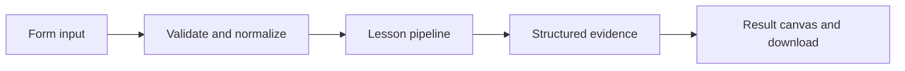

# How A dataset with provenance works

Create and list versionable local evaluation examples, with optional explicit LangSmith upload code documented separately.

## Why LangChain
LangChain supplies composable messages, prompts, model adapters, documents, or retrieval contracts. Pure local processing may be simpler without it; the lesson isolates the named engineering concept before introducing external services.

## Imports
`Path` resolves local configuration; `os` reads variable names; `json` encodes evidence; `time` measures local duration; `streamlit` renders the interface; `load_dotenv` loads optional configuration without replacing injected values. `ChatPromptTemplate` structures messages; `StrOutputParser` extracts text; `RunnableLambda` wraps Python functions; message classes represent chat roles; `ChatOpenAI` is used only by offered live paths. Additional concept-specific imports appear in the source below.

## Data flow


## Concept-specific implementation, annotated by source
Read this complete runnable core alongside app.py. Validation precedes processing; the returned dictionary defines what the UI displays.

```python
import sqlite3
import uuid
DATA_DIR=Path(__file__).with_name('.local')
def dataset_db():
    DATA_DIR.mkdir(exist_ok=True,parents=True)
    db=sqlite3.connect(DATA_DIR/'datasets.sqlite')
    db.execute('CREATE TABLE IF NOT EXISTS examples(id TEXT PRIMARY KEY, dataset TEXT NOT NULL, input TEXT NOT NULL, reference TEXT NOT NULL)')
    return db

from langsmith import Client

def langsmith_client():
    key=os.getenv('LANGSMITH_API_KEY','').strip()
    if not key or key=='YOUR_LANGSMITH_API_KEY_HERE':raise ValueError('Set LANGSMITH_API_KEY in .env for live LangSmith operations.')
    return Client(api_key=key)

def run_local(data,live=False,model=None):
    name=require_text(data['dataset'],80);question=require_text(data['question'],2000);reference=require_text(data['reference'],4000)
    identifier=str(uuid.uuid4())
    with dataset_db() as db:
        db.execute('INSERT INTO examples VALUES (?,?,?,?)',(identifier,name,question,reference))
        rows=db.execute('SELECT id,input,reference FROM examples WHERE dataset=? ORDER BY rowid',(name,)).fetchall()
    return {'dataset':name,'created':{'id':identifier,'input':question,'reference':reference},'examples':[{'id':i,'input':q,'reference':r} for i,q,r in rows],'storage':'local SQLite; not a LangSmith cloud dataset'}


def run(data,live=False,model=None):
    if not live:return run_local(data)
    from langsmith.utils import LangSmithNotFoundError
    name=require_text(data['dataset'],80);question=require_text(data['question'],2000);reference=require_text(data['reference'],4000)
    client=model if model is not None else langsmith_client()
    try:dataset=client.read_dataset(dataset_name=name)
    except LangSmithNotFoundError:dataset=client.create_dataset(dataset_name=name,description='Agent engineering learning examples; no sensitive data.')
    example=client.create_example(inputs={'question':question},outputs={'answer':reference},dataset_id=dataset.id)
    return {'dataset':name,'dataset_id':str(dataset.id),'example_id':str(example.id),'service':'LangSmith cloud write acknowledged; inspect the dataset in your account'}
```

## Important lines
- `def dataset_db():` — defines a callable stage and its input contract.
- `return db` — returns the observable result consumed by tests and the evidence canvas.
- `def run(data,live=False,model=None):` — defines a callable stage and its input contract.
- `return {'dataset':name,'created':{'id':identifier,'input':question,'reference':reference},'examples':[{'id':i,'input':q,'reference':r} for i,q,r in rows],'storage':'local SQLite; not a LangSmith cloud dataset'}` — returns the observable result consumed by tests and the evidence canvas.

## Interface and reliability
The form submits related inputs together. Session state retains the last result; reset clears it. A spinner provides loading feedback. Input errors are shown in context; unknown provider errors are sanitized. Static HTML styles contain no user text. Every output carries explicit local/live labeling. The timer is not a provider latency benchmark. Local tests do not establish live provider correctness, visual browser quality, or production deployment.
