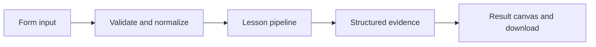

# How Compare experiments works

Evaluate two deterministic candidate versions on one dataset and inspect per-example scores and aggregate results.

## Why LangChain
LangChain supplies composable messages, prompts, model adapters, documents, or retrieval contracts. Pure local processing may be simpler without it; the lesson isolates the named engineering concept before introducing external services.

## Imports
`Path` resolves local configuration; `os` reads variable names; `json` encodes evidence; `time` measures local duration; `streamlit` renders the interface; `load_dotenv` loads optional configuration without replacing injected values. `ChatPromptTemplate` structures messages; `StrOutputParser` extracts text; `RunnableLambda` wraps Python functions; message classes represent chat roles; `ChatOpenAI` is used only by offered live paths. Additional concept-specific imports appear in the source below.

## Data flow


## Concept-specific implementation, annotated by source
Read this complete runnable core alongside app.py. Validation precedes processing; the returned dictionary defines what the UI displays.

```python
import re

def normalize_answer(text): return ' '.join(re.findall(r'\w+',text.casefold()))
def exact_match(prediction,reference): return normalize_answer(prediction)==normalize_answer(reference)
def token_f1(prediction,reference):
    from collections import Counter
    p=Counter(normalize_answer(prediction).split());r=Counter(normalize_answer(reference).split())
    common=sum((p&r).values())
    if not p or not r:return float(p==r)
    precision=common/sum(p.values());recall=common/sum(r.values())
    return round(2*precision*recall/(precision+recall),6) if precision+recall else 0.0

from langsmith import Client

def langsmith_client():
    key=os.getenv('LANGSMITH_API_KEY','').strip()
    if not key or key=='YOUR_LANGSMITH_API_KEY_HERE':raise ValueError('Set LANGSMITH_API_KEY in .env for live LangSmith operations.')
    return Client(api_key=key)

def run_local(data,live=False,model=None):
    rows=json.loads(data['examples']) if isinstance(data['examples'],str) else data['examples']
    if not isinstance(rows,list) or not 1<=len(rows)<=100: raise ValueError('Use 1–100 examples.')
    results=[]
    for row in rows:
        question=require_text(row['input'],2000);reference=require_text(row['reference'],4000)
        for version,prediction in [('echo-v1',question),('prefix-v2','answer '+question)]:
            results.append({'version':version,'input':question,'prediction':prediction,'score':int(exact_match(prediction,reference))})
    scores={version:sum(r['score'] for r in results if r['version']==version)/len(rows) for version in ('echo-v1','prefix-v2')}
    return {'results':results,'scores':scores,'examples':len(rows),'service':'local experiment runner, not a LangSmith experiment'}


def run_cloud_experiments(client,runner=None):
    if runner is None:
        from langsmith.evaluation import evaluate
        runner=evaluate
    dataset=os.getenv('LANGSMITH_DATASET','agent-basics')
    def evaluator(run,example):
        return {'key':'normalized_exact_match','score':exact_match(str((run.outputs or {}).get('answer','')),str((example.outputs or {}).get('answer','')))}
    summaries=[]
    for version in ('echo-v1','prefix-v2'):
        def target(inputs,version=version):
            text=str(inputs['question']);return {'answer':text if version=='echo-v1' else 'answer '+text}
        result=runner(target,data=dataset,evaluators=[evaluator],experiment_prefix=version,client=client,max_concurrency=1,blocking=True)
        values=[]
        for row in result:
            values.extend(float(score.score) for score in row['evaluation_results']['results'] if score.score is not None)
        if not values:raise ValueError('The cloud experiment produced no evaluator scores. Check the dataset and result errors.')
        summaries.append({'version':version,'experiment':result.experiment_name,'scores':len(values),'mean_score':sum(values)/len(values)})
    return {'experiments':summaries,'dataset':dataset,'service':'LangSmith SDK experiments; candidate versions are deterministic teaching functions'}

def run(data,live=False,model=None):
    if not live:return run_local(data)
    return run_cloud_experiments(model if model is not None else langsmith_client())
```

## Important lines
- `def normalize_answer(text): return ' '.join(re.findall(r'\w+',text.casefold()))` — defines a callable stage and its input contract.
- `def exact_match(prediction,reference): return normalize_answer(prediction)==normalize_answer(reference)` — defines a callable stage and its input contract.
- `def token_f1(prediction,reference):` — defines a callable stage and its input contract.
- `return round(2*precision*recall/(precision+recall),6) if precision+recall else 0.0` — returns the observable result consumed by tests and the evidence canvas.
- `def run(data,live=False,model=None):` — defines a callable stage and its input contract.
- `return {'results':results,'scores':scores,'examples':len(rows),'service':'local experiment runner, not a LangSmith experiment'}` — returns the observable result consumed by tests and the evidence canvas.

## Interface and reliability
The form submits related inputs together. Session state retains the last result; reset clears it. A spinner provides loading feedback. Input errors are shown in context; unknown provider errors are sanitized. Static HTML styles contain no user text. Every output carries explicit local/live labeling. The timer is not a provider latency benchmark. Local tests do not establish live provider correctness, visual browser quality, or production deployment.
