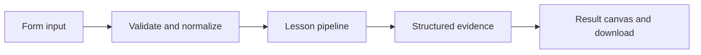

# How Evaluate before and after release works

Run reference-based offline checks or reference-free production-run checks with deterministic sampling.

## Why LangChain
LangChain supplies composable messages, prompts, model adapters, documents, or retrieval contracts. Pure local processing may be simpler without it; the lesson isolates the named engineering concept before introducing external services.

## Imports
`Path` resolves local configuration; `os` reads variable names; `json` encodes evidence; `time` measures local duration; `streamlit` renders the interface; `load_dotenv` loads optional configuration without replacing injected values. `ChatPromptTemplate` structures messages; `StrOutputParser` extracts text; `RunnableLambda` wraps Python functions; message classes represent chat roles; `ChatOpenAI` is used only by offered live paths. Additional concept-specific imports appear in the source below.

## Data flow


## Concept-specific implementation, annotated by source
Read this complete runnable core alongside app.py. Validation precedes processing; the returned dictionary defines what the UI displays.

```python
import re

def normalize_answer(text): return ' '.join(re.findall(r'\w+',text.casefold()))
def exact_match(prediction,reference): return normalize_answer(prediction)==normalize_answer(reference)
def token_f1(prediction,reference):
    from collections import Counter
    p=Counter(normalize_answer(prediction).split());r=Counter(normalize_answer(reference).split())
    common=sum((p&r).values())
    if not p or not r:return float(p==r)
    precision=common/sum(p.values());recall=common/sum(r.values())
    return round(2*precision*recall/(precision+recall),6) if precision+recall else 0.0

from langsmith import Client

def langsmith_client():
    key=os.getenv('LANGSMITH_API_KEY','').strip()
    if not key or key=='YOUR_LANGSMITH_API_KEY_HERE':raise ValueError('Set LANGSMITH_API_KEY in .env for live LangSmith operations.')
    return Client(api_key=key)

def run_local(data,live=False,model=None):
    mode=data['mode'];rows=json.loads(data['records']) if isinstance(data['records'],str) else data['records']
    if mode not in ('offline','online') or not isinstance(rows,list) or not 1<=len(rows)<=100: raise ValueError('Choose a mode and 1–100 records.')
    results=[]
    for row in rows:
        prediction=str(row['prediction'])
        if mode=='offline':
            reference=require_text(row['reference'],4000);score=int(exact_match(prediction,reference));metric='reference_exact_match'
        else:
            latency=float(row['latency_ms'])
            if latency<0: raise ValueError('Latency cannot be negative.')
            score=int(bool(prediction.strip()) and latency<=1000);metric='nonempty_and_under_1_second; not factual correctness'
        results.append({'id':str(row['id']),'score':score,'metric':metric})
    return {'mode':mode,'results':results,'mean_score':sum(r['score'] for r in results)/len(results),'service':'local evaluation simulation; no production hook registered'}


def run(data,live=False,model=None):
    if not live:return run_local(data)
    import uuid
    if data['mode']!='online':raise ValueError('Use online mode to attach feedback to existing LangSmith runs. Use I18 for offline cloud experiments.')
    rows=json.loads(data['records']) if isinstance(data['records'],str) else data['records']
    if not isinstance(rows,list) or not 1<=len(rows)<=100:raise ValueError('Use 1–100 recorded run IDs.')
    identifiers=[str(uuid.UUID(str(row['id']))) for row in rows]
    client=model if model is not None else langsmith_client();feedback=[]
    for identifier in identifiers:
        run=client.read_run(identifier)
        if run.end_time is None:raise ValueError('Cannot evaluate an unfinished run.')
        latency=(run.end_time-run.start_time).total_seconds()*1000
        prediction=str((run.outputs or {}).get('answer',''));score=int(bool(prediction.strip()) and 0<=latency<=1000)
        item=client.create_feedback(run_id=identifier,key='learning_nonempty_under_1s',score=score,comment='Client-side reference-free teaching evaluator; not factual correctness.')
        feedback.append({'run_id':identifier,'feedback_id':str(item.id),'score':score})
    return {'feedback':feedback,'service':'client-side feedback attached to existing cloud runs; no server-side online evaluator rule registered'}
```

## Important lines
- `def normalize_answer(text): return ' '.join(re.findall(r'\w+',text.casefold()))` — defines a callable stage and its input contract.
- `def exact_match(prediction,reference): return normalize_answer(prediction)==normalize_answer(reference)` — defines a callable stage and its input contract.
- `def token_f1(prediction,reference):` — defines a callable stage and its input contract.
- `return round(2*precision*recall/(precision+recall),6) if precision+recall else 0.0` — returns the observable result consumed by tests and the evidence canvas.
- `def run(data,live=False,model=None):` — defines a callable stage and its input contract.
- `return {'mode':mode,'results':results,'mean_score':sum(r['score'] for r in results)/len(results),'service':'local evaluation simulation; no production hook registered'}` — returns the observable result consumed by tests and the evidence canvas.

## Interface and reliability
The form submits related inputs together. Session state retains the last result; reset clears it. A spinner provides loading feedback. Input errors are shown in context; unknown provider errors are sanitized. Static HTML styles contain no user text. Every output carries explicit local/live labeling. The timer is not a provider latency benchmark. Local tests do not establish live provider correctness, visual browser quality, or production deployment.
