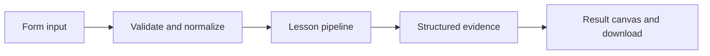

# How Align the evaluator works

Compare human and evaluator labels with a confusion matrix, agreement, precision, and recall.

## Why LangChain
LangChain supplies composable messages, prompts, model adapters, documents, or retrieval contracts. Pure local processing may be simpler without it; the lesson isolates the named engineering concept before introducing external services.

## Imports
`Path` resolves local configuration; `os` reads variable names; `json` encodes evidence; `time` measures local duration; `streamlit` renders the interface; `load_dotenv` loads optional configuration without replacing injected values. `ChatPromptTemplate` structures messages; `StrOutputParser` extracts text; `RunnableLambda` wraps Python functions; message classes represent chat roles; `ChatOpenAI` is used only by offered live paths. Additional concept-specific imports appear in the source below.

## Data flow


## Concept-specific implementation, annotated by source
Read this complete runnable core alongside app.py. Validation precedes processing; the returned dictionary defines what the UI displays.

```python
def run(data,live=False,model=None):
    rows=json.loads(data['labels']) if isinstance(data['labels'],str) else data['labels']
    if not isinstance(rows,list) or not 1<=len(rows)<=1000: raise ValueError('Supply 1–1000 labeled examples.')
    matrix={'tp':0,'fp':0,'tn':0,'fn':0}
    for row in rows:
        human=row['human'];judge=row['judge']
        if type(human) is not int or type(judge) is not int or human not in (0,1) or judge not in (0,1): raise ValueError('Labels must be integer 0 or 1.')
        matrix['tp' if human==judge==1 else 'tn' if human==judge==0 else 'fp' if judge else 'fn']+=1
    tp,fp,fn=matrix['tp'],matrix['fp'],matrix['fn']
    return {'matrix':matrix,'agreement':(matrix['tp']+matrix['tn'])/len(rows),'precision':tp/(tp+fp) if tp+fp else None,'recall':tp/(tp+fn) if tp+fn else None,'undefined_metrics':'null means no denominator; do not substitute perfect alignment'}
```

## Important lines
- `def run(data,live=False,model=None):` — defines a callable stage and its input contract.
- `return {'matrix':matrix,'agreement':(matrix['tp']+matrix['tn'])/len(rows),'precision':tp/(tp+fp) if tp+fp else None,'recall':tp/(tp+fn) if tp+fn else None,'undefined_metrics':'null means no denominator; do not substitute perfect alignment'}` — returns the observable result consumed by tests and the evidence canvas.

## Interface and reliability
The form submits related inputs together. Session state retains the last result; reset clears it. A spinner provides loading feedback. Input errors are shown in context; unknown provider errors are sanitized. Static HTML styles contain no user text. Every output carries explicit local/live labeling. The timer is not a provider latency benchmark. Local tests do not establish live provider correctness, visual browser quality, or production deployment.
