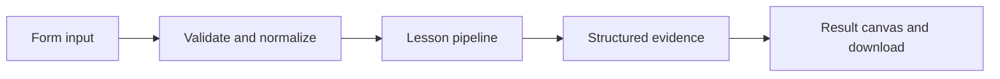

# How Work that can resume works

Checkpoint a multi-step job between units and continue it from the same thread after process restarts.

## Why LangChain
LangChain supplies composable messages, prompts, model adapters, documents, or retrieval contracts. Pure local processing may be simpler without it; the lesson isolates the named engineering concept before introducing external services.

## Imports
`Path` resolves local configuration; `os` reads variable names; `json` encodes evidence; `time` measures local duration; `streamlit` renders the interface; `load_dotenv` loads optional configuration without replacing injected values. `ChatPromptTemplate` structures messages; `StrOutputParser` extracts text; `RunnableLambda` wraps Python functions; message classes represent chat roles; `ChatOpenAI` is used only by offered live paths. Additional concept-specific imports appear in the source below.

## Data flow


## Concept-specific implementation, annotated by source
Read this complete runnable core alongside app.py. Validation precedes processing; the returned dictionary defines what the UI displays.

```python
from typing_extensions import TypedDict
from langgraph.graph import StateGraph, START, END

from langgraph.checkpoint.sqlite import SqliteSaver
DATA_DIR=Path(__file__).with_name('.local')
class JobState(TypedDict):
    items:list[str]
    cursor:int
    completed:list[str]

def build_job(saver):
    graph=StateGraph(JobState)
    def process(state):
        i=state['cursor'];return {'cursor':i+1,'completed':state['completed']+[state['items'][i].upper()]}
    graph.add_node('process',process)
    graph.add_edge(START,'process')
    graph.add_conditional_edges('process',lambda s:'process' if s['cursor']<len(s['items']) else END,{'process':'process',END:END})
    return graph.compile(checkpointer=saver,interrupt_before=['process'])

def run(data,live=False,model=None):
    job=require_text(data['job'],80);action=data['action']
    if action not in ('start','continue'):raise ValueError('Choose start or continue.')
    DATA_DIR.mkdir(parents=True,exist_ok=True)
    with SqliteSaver.from_conn_string(str(DATA_DIR/'jobs.sqlite')) as saver:
        graph=build_job(saver);config={'configurable':{'thread_id':job}}
        if action=='start':
            items=json.loads(data['items']) if isinstance(data['items'],str) else data['items']
            if not isinstance(items,list) or not 1<=len(items)<=20:raise ValueError('Supply 1–20 work items.')
            items=[require_text(x,200) for x in items]
            if graph.get_state(config).values:raise ValueError('Job already exists; continue it or use a new ID.')
            result=graph.invoke({'items':items,'cursor':0,'completed':[]},config)
        else:
            snapshot=graph.get_state(config)
            if not snapshot.values:raise ValueError('Start this job first.')
            result=graph.invoke(None,config) if snapshot.next else snapshot.values
        return {**dict(result),'pending':bool(graph.get_state(config).next),'job':job}
```

## Important lines
- `def build_job(saver):` — defines a callable stage and its input contract.
- `def process(state):` — defines a callable stage and its input contract.
- `return graph.compile(checkpointer=saver,interrupt_before=['process'])` — returns the observable result consumed by tests and the evidence canvas.
- `def run(data,live=False,model=None):` — defines a callable stage and its input contract.
- `result=graph.invoke({'items':items,'cursor':0,'completed':[]},config)` — executes the composed pipeline with the prepared input.
- `result=graph.invoke(None,config) if snapshot.next else snapshot.values` — executes the composed pipeline with the prepared input.
- `return {**dict(result),'pending':bool(graph.get_state(config).next),'job':job}` — returns the observable result consumed by tests and the evidence canvas.

## Interface and reliability
The form submits related inputs together. Session state retains the last result; reset clears it. A spinner provides loading feedback. Input errors are shown in context; unknown provider errors are sanitized. Static HTML styles contain no user text. Every output carries explicit local/live labeling. The timer is not a provider latency benchmark. Local tests do not establish live provider correctness, visual browser quality, or production deployment.
