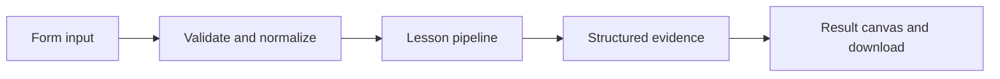

# How A restricted execution boundary works

Evaluate only allowlisted arithmetic in a resource-limited child process; arbitrary generated Python is refused.

## Why LangChain
LangChain supplies composable messages, prompts, model adapters, documents, or retrieval contracts. Pure local processing may be simpler without it; the lesson isolates the named engineering concept before introducing external services.

## Imports
`Path` resolves local configuration; `os` reads variable names; `json` encodes evidence; `time` measures local duration; `streamlit` renders the interface; `load_dotenv` loads optional configuration without replacing injected values. `ChatPromptTemplate` structures messages; `StrOutputParser` extracts text; `RunnableLambda` wraps Python functions; message classes represent chat roles; `ChatOpenAI` is used only by offered live paths. Additional concept-specific imports appear in the source below.

## Data flow


## Concept-specific implementation, annotated by source
Read this complete runnable core alongside app.py. Validation precedes processing; the returned dictionary defines what the UI displays.

```python
import subprocess
import sys
import ast

def run(data,live=False,model=None):
    expression=require_text(data['expression'],200)
    try:tree=ast.parse(expression,mode='eval')
    except SyntaxError as exc:raise ValueError('Enter a valid arithmetic expression.') from exc
    allowed=(ast.Expression,ast.BinOp,ast.UnaryOp,ast.Add,ast.Sub,ast.Mult,ast.Div,ast.UAdd,ast.USub,ast.Constant)
    if len(list(ast.walk(tree)))>50 or any(not isinstance(n,allowed) or (isinstance(n,ast.Constant) and type(n.value) not in (int,float)) for n in ast.walk(tree)):raise ValueError('Only bounded arithmetic AST nodes are permitted. No names, calls, attributes, loops, or imports.')
    worker=Path(__file__).with_name('worker.py')
    try:result=subprocess.run([sys.executable,'-I','-S',str(worker)],input=expression,text=True,capture_output=True,timeout=3,check=False,cwd=str(worker.parent))
    except subprocess.TimeoutExpired as exc:raise ValueError('Restricted worker exceeded its time limit.') from exc
    if result.returncode:raise ValueError('Restricted worker rejected the expression.')
    return {'answer':result.stdout.strip(),'execution':'fixed worker subprocess; no eval or exec','os_isolation':'resource limits on Unix; no seccomp/container boundary; never use for arbitrary code'}
```

## Important lines
- `def run(data,live=False,model=None):` — defines a callable stage and its input contract.
- `return {'answer':result.stdout.strip(),'execution':'fixed worker subprocess; no eval or exec','os_isolation':'resource limits on Unix; no seccomp/container boundary; never use for arbitrary code'}` — returns the observable result consumed by tests and the evidence canvas.

## Interface and reliability
The form submits related inputs together. Session state retains the last result; reset clears it. A spinner provides loading feedback. Input errors are shown in context; unknown provider errors are sanitized. Static HTML styles contain no user text. Every output carries explicit local/live labeling. The timer is not a provider latency benchmark. Local tests do not establish live provider correctness, visual browser quality, or production deployment.
