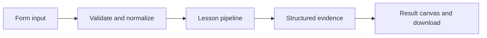

# How Parallel perspectives works

Run two graph branches with reducer-based state, then synthesize their evidence after a join.

## Why LangChain
LangChain supplies composable messages, prompts, model adapters, documents, or retrieval contracts. Pure local processing may be simpler without it; the lesson isolates the named engineering concept before introducing external services.

## Imports
`Path` resolves local configuration; `os` reads variable names; `json` encodes evidence; `time` measures local duration; `streamlit` renders the interface; `load_dotenv` loads optional configuration without replacing injected values. `ChatPromptTemplate` structures messages; `StrOutputParser` extracts text; `RunnableLambda` wraps Python functions; message classes represent chat roles; `ChatOpenAI` is used only by offered live paths. Additional concept-specific imports appear in the source below.

## Data flow


## Concept-specific implementation, annotated by source
Read this complete runnable core alongside app.py. Validation precedes processing; the returned dictionary defines what the UI displays.

```python
from typing_extensions import TypedDict
from langgraph.graph import StateGraph, START, END

import operator
from typing import Annotated
class TeamState(TypedDict):
    topic:str
    reports:Annotated[list[str],operator.add]
    answer:str

def run(data,live=False,model=None):
    topic=require_text(data['topic'],2000)
    graph=StateGraph(TeamState)
    graph.add_node('research',lambda s:{'reports':['Research: define evidence for '+s['topic']]})
    graph.add_node('review',lambda s:{'reports':['Review: test failure cases for '+s['topic']]})
    graph.add_node('synthesize',lambda s:{'answer':'\n'.join(sorted(s['reports']))})
    graph.add_edge(START,'research');graph.add_edge(START,'review');graph.add_edge(['research','review'],'synthesize');graph.add_edge('synthesize',END)
    result=graph.compile().invoke({'topic':topic,'reports':[]})
    return {**dict(result),'branches':len(result['reports']),'implementation':'parallel deterministic specialists; no claim of autonomous research'}
```

## Important lines
- `def run(data,live=False,model=None):` — defines a callable stage and its input contract.
- `result=graph.compile().invoke({'topic':topic,'reports':[]})` — executes the composed pipeline with the prepared input.
- `return {**dict(result),'branches':len(result['reports']),'implementation':'parallel deterministic specialists; no claim of autonomous research'}` — returns the observable result consumed by tests and the evidence canvas.

## Interface and reliability
The form submits related inputs together. Session state retains the last result; reset clears it. A spinner provides loading feedback. Input errors are shown in context; unknown provider errors are sanitized. Static HTML styles contain no user text. Every output carries explicit local/live labeling. The timer is not a provider latency benchmark. Local tests do not establish live provider correctness, visual browser quality, or production deployment.
