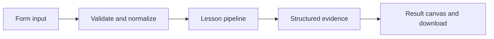

# How Recover with intent works

Retry only transient graph failures and inspect attempt counts, bounded retries, and idempotent results.

## Why LangChain
LangChain supplies composable messages, prompts, model adapters, documents, or retrieval contracts. Pure local processing may be simpler without it; the lesson isolates the named engineering concept before introducing external services.

## Imports
`Path` resolves local configuration; `os` reads variable names; `json` encodes evidence; `time` measures local duration; `streamlit` renders the interface; `load_dotenv` loads optional configuration without replacing injected values. `ChatPromptTemplate` structures messages; `StrOutputParser` extracts text; `RunnableLambda` wraps Python functions; message classes represent chat roles; `ChatOpenAI` is used only by offered live paths. Additional concept-specific imports appear in the source below.

## Data flow


## Concept-specific implementation, annotated by source
Read this complete runnable core alongside app.py. Validation precedes processing; the returned dictionary defines what the UI displays.

```python
from typing_extensions import TypedDict
from langgraph.graph import StateGraph, START, END

from langgraph.types import RetryPolicy
class TransientError(Exception):pass
class RetryState(TypedDict):
    value:str
    answer:str

def run(data,live=False,model=None):
    value=require_text(data['value'],2000);failures=int(data['transient_failures'])
    if not 0<=failures<=2:raise ValueError('Use 0–2 transient failures.')
    attempts=[]
    def work(state):
        attempts.append(len(attempts)+1)
        if len(attempts)<=failures:raise TransientError('Injected retryable failure')
        return {'answer':state['value'].upper()}
    graph=StateGraph(RetryState);graph.add_node('work',work,retry_policy=RetryPolicy(initial_interval=.01,backoff_factor=1,max_interval=.01,max_attempts=3,jitter=False,retry_on=TransientError));graph.add_edge(START,'work');graph.add_edge('work',END)
    result=graph.compile().invoke({'value':value})
    return {**dict(result),'attempts':len(attempts),'external_side_effects':False}
```

## Important lines
- `def run(data,live=False,model=None):` — defines a callable stage and its input contract.
- `def work(state):` — defines a callable stage and its input contract.
- `return {'answer':state['value'].upper()}` — returns the observable result consumed by tests and the evidence canvas.
- `result=graph.compile().invoke({'value':value})` — executes the composed pipeline with the prepared input.
- `return {**dict(result),'attempts':len(attempts),'external_side_effects':False}` — returns the observable result consumed by tests and the evidence canvas.

## Interface and reliability
The form submits related inputs together. Session state retains the last result; reset clears it. A spinner provides loading feedback. Input errors are shown in context; unknown provider errors are sanitized. Static HTML styles contain no user text. Every output carries explicit local/live labeling. The timer is not a provider latency benchmark. Local tests do not establish live provider correctness, visual browser quality, or production deployment.
