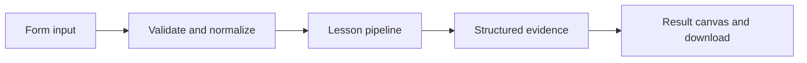

# How A graph ready to serve works

Build and invoke an exportable graph with a deployment manifest and a local HTTP endpoint; cloud deployment remains separate.

## Why LangChain
LangChain supplies composable messages, prompts, model adapters, documents, or retrieval contracts. Pure local processing may be simpler without it; the lesson isolates the named engineering concept before introducing external services.

## Imports
`Path` resolves local configuration; `os` reads variable names; `json` encodes evidence; `time` measures local duration; `streamlit` renders the interface; `load_dotenv` loads optional configuration without replacing injected values. `ChatPromptTemplate` structures messages; `StrOutputParser` extracts text; `RunnableLambda` wraps Python functions; message classes represent chat roles; `ChatOpenAI` is used only by offered live paths. Additional concept-specific imports appear in the source below.

## Data flow


## Concept-specific implementation, annotated by source
Read this complete runnable core alongside app.py. Validation precedes processing; the returned dictionary defines what the UI displays.

```python
from typing_extensions import TypedDict
from langgraph.graph import StateGraph, START, END

class DeployState(TypedDict):
    text:str
    answer:str

def make_graph():
    graph=StateGraph(DeployState);graph.add_node('respond',lambda s:{'answer':'Graph response: '+require_text(s['text'],2000)});graph.add_edge(START,'respond');graph.add_edge('respond',END)
    return graph.compile()
graph=make_graph()

def run(data,live=False,model=None):
    result=graph.invoke({'text':require_text(data['text'],2000)})
    return {**dict(result),'deployment':'local graph invocation only; manifest is not proof of cloud deployment'}
```

## Important lines
- `def make_graph():` — defines a callable stage and its input contract.
- `return graph.compile()` — returns the observable result consumed by tests and the evidence canvas.
- `def run(data,live=False,model=None):` — defines a callable stage and its input contract.
- `result=graph.invoke({'text':require_text(data['text'],2000)})` — executes the composed pipeline with the prepared input.
- `return {**dict(result),'deployment':'local graph invocation only; manifest is not proof of cloud deployment'}` — returns the observable result consumed by tests and the evidence canvas.

## Interface and reliability
The form submits related inputs together. Session state retains the last result; reset clears it. A spinner provides loading feedback. Input errors are shown in context; unknown provider errors are sanitized. Static HTML styles contain no user text. Every output carries explicit local/live labeling. The timer is not a provider latency benchmark. Local tests do not establish live provider correctness, visual browser quality, or production deployment.
