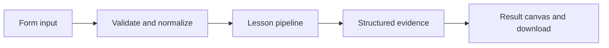

# How Revisions and assistants works

Persist immutable local configuration revisions and update an assistant to point to a chosen revision.

## Why LangChain
LangChain supplies composable messages, prompts, model adapters, documents, or retrieval contracts. Pure local processing may be simpler without it; the lesson isolates the named engineering concept before introducing external services.

## Imports
`Path` resolves local configuration; `os` reads variable names; `json` encodes evidence; `time` measures local duration; `streamlit` renders the interface; `load_dotenv` loads optional configuration without replacing injected values. `ChatPromptTemplate` structures messages; `StrOutputParser` extracts text; `RunnableLambda` wraps Python functions; message classes represent chat roles; `ChatOpenAI` is used only by offered live paths. Additional concept-specific imports appear in the source below.

## Data flow


## Concept-specific implementation, annotated by source
Read this complete runnable core alongside app.py. Validation precedes processing; the returned dictionary defines what the UI displays.

```python
import sqlite3
import uuid
import hashlib
DATA_DIR=Path(__file__).with_name('.local')
from contextlib import contextmanager
@contextmanager
def connect():
    DATA_DIR.mkdir(exist_ok=True,parents=True)
    db=sqlite3.connect(DATA_DIR/'platform.sqlite')
    try:
        with db:yield db
    finally:db.close()

def run(data,live=False,model=None):
    assistant=require_text(data['assistant'],80);instructions=require_text(data['instructions'],4000)
    revision=hashlib.sha256(instructions.encode()).hexdigest()
    with connect() as db:
        db.execute('CREATE TABLE IF NOT EXISTS revisions(id TEXT PRIMARY KEY,instructions TEXT NOT NULL)')
        db.execute('CREATE TABLE IF NOT EXISTS assistants(name TEXT PRIMARY KEY,revision TEXT NOT NULL REFERENCES revisions(id))')
        db.execute('PRAGMA foreign_keys=ON')
        db.execute('INSERT OR IGNORE INTO revisions VALUES (?,?)',(revision,instructions))
        db.execute('INSERT INTO assistants VALUES (?,?) ON CONFLICT(name) DO UPDATE SET revision=excluded.revision',(assistant,revision))
    return {'assistant':assistant,'revision':revision,'instructions':instructions,'semantics':'local configuration versioning; managed deployment revisions version deployed code/config, assistants configure a graph; not a cloud API replica'}
```

## Important lines
- `def connect():` — defines a callable stage and its input contract.
- `return sqlite3.connect(DATA_DIR/'platform.sqlite')` — returns the observable result consumed by tests and the evidence canvas.
- `def run(data,live=False,model=None):` — defines a callable stage and its input contract.
- `return {'assistant':assistant,'revision':revision,'instructions':instructions,'semantics':'local configuration versioning; managed deployment revisions version deployed code/config, assistants configure a graph; not a cloud API replica'}` — returns the observable result consumed by tests and the evidence canvas.

## Interface and reliability
The form submits related inputs together. Session state retains the last result; reset clears it. A spinner provides loading feedback. Input errors are shown in context; unknown provider errors are sanitized. Static HTML styles contain no user text. Every output carries explicit local/live labeling. The timer is not a provider latency benchmark. Local tests do not establish live provider correctness, visual browser quality, or production deployment.
