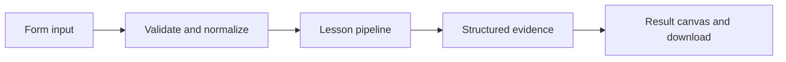

# How Threads and runs works

Keep conversation threads separate from execution records and inspect stored run status and output.

## Why LangChain
LangChain supplies composable messages, prompts, model adapters, documents, or retrieval contracts. Pure local processing may be simpler without it; the lesson isolates the named engineering concept before introducing external services.

## Imports
`Path` resolves local configuration; `os` reads variable names; `json` encodes evidence; `time` measures local duration; `streamlit` renders the interface; `load_dotenv` loads optional configuration without replacing injected values. `ChatPromptTemplate` structures messages; `StrOutputParser` extracts text; `RunnableLambda` wraps Python functions; message classes represent chat roles; `ChatOpenAI` is used only by offered live paths. Additional concept-specific imports appear in the source below.

## Data flow


## Concept-specific implementation, annotated by source
Read this complete runnable core alongside app.py. Validation precedes processing; the returned dictionary defines what the UI displays.

```python
import sqlite3
import uuid
import hashlib
DATA_DIR=Path(__file__).with_name('.local')
from contextlib import contextmanager
@contextmanager
def connect():
    DATA_DIR.mkdir(exist_ok=True,parents=True)
    db=sqlite3.connect(DATA_DIR/'platform.sqlite')
    try:
        with db:yield db
    finally:db.close()

def run(data,live=False,model=None):
    thread=require_text(data['thread'],80);message=require_text(data['message'],2000);run_id=str(uuid.uuid4())
    with connect() as db:
        db.execute('PRAGMA foreign_keys=ON')
        db.execute('CREATE TABLE IF NOT EXISTS threads(id TEXT PRIMARY KEY)')
        db.execute('CREATE TABLE IF NOT EXISTS runs(id TEXT PRIMARY KEY,thread TEXT REFERENCES threads(id),status TEXT,input TEXT,output TEXT)')
        db.execute('INSERT OR IGNORE INTO threads VALUES (?)',(thread,))
        db.execute('INSERT INTO runs VALUES (?,?,?,?,?)',(run_id,thread,'pending',message,None))
        answer='Local run: '+message
        db.execute('UPDATE runs SET status=?,output=? WHERE id=?',('success',answer,run_id))
        count=db.execute('SELECT COUNT(*) FROM runs WHERE thread=?',(thread,)).fetchone()[0]
    return {'thread':thread,'run_id':run_id,'status':'success','answer':answer,'thread_run_count':count,'service':'local durable run ledger; no LangSmith deployment request'}
```

## Important lines
- `def connect():` — defines a callable stage and its input contract.
- `return sqlite3.connect(DATA_DIR/'platform.sqlite')` — returns the observable result consumed by tests and the evidence canvas.
- `def run(data,live=False,model=None):` — defines a callable stage and its input contract.
- `return {'thread':thread,'run_id':run_id,'status':'success','answer':answer,'thread_run_count':count,'service':'local durable run ledger; no LangSmith deployment request'}` — returns the observable result consumed by tests and the evidence canvas.

## Interface and reliability
The form submits related inputs together. Session state retains the last result; reset clears it. A spinner provides loading feedback. Input errors are shown in context; unknown provider errors are sanitized. Static HTML styles contain no user text. Every output carries explicit local/live labeling. The timer is not a provider latency benchmark. Local tests do not establish live provider correctness, visual browser quality, or production deployment.
