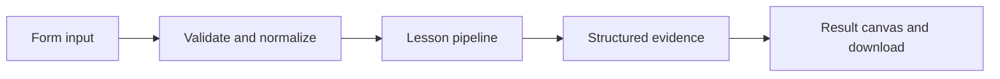

# How Who are you, and may you act? works

Authenticate an HMAC-signed local token and enforce tenant and role authorization separately.

## Why LangChain
LangChain supplies composable messages, prompts, model adapters, documents, or retrieval contracts. Pure local processing may be simpler without it; the lesson isolates the named engineering concept before introducing external services.

## Imports
`Path` resolves local configuration; `os` reads variable names; `json` encodes evidence; `time` measures local duration; `streamlit` renders the interface; `load_dotenv` loads optional configuration without replacing injected values. `ChatPromptTemplate` structures messages; `StrOutputParser` extracts text; `RunnableLambda` wraps Python functions; message classes represent chat roles; `ChatOpenAI` is used only by offered live paths. Additional concept-specific imports appear in the source below.

## Data flow


## Concept-specific implementation, annotated by source
Read this complete runnable core alongside app.py. Validation precedes processing; the returned dictionary defines what the UI displays.

```python
import base64
import hashlib
import hmac

def encode_token(claims,key):
    body=base64.urlsafe_b64encode(json.dumps(claims,sort_keys=True).encode()).decode()
    return body+'.'+hmac.new(key,body.encode(),hashlib.sha256).hexdigest()
def verify_token(token,key,now=None):
    try:
        body,signature=token.split('.')
        expected=hmac.new(key,body.encode(),hashlib.sha256).hexdigest()
        if not hmac.compare_digest(signature,expected):raise ValueError('Invalid token signature.')
        claims=json.loads(base64.urlsafe_b64decode(body))
        if claims['exp']<=(time.time() if now is None else now):raise ValueError('Expired token.')
        if claims['role'] not in ('viewer','editor'):raise ValueError('Invalid role.')
        return claims
    except (KeyError,TypeError,ValueError) as exc:raise ValueError('Authentication failed.') from exc

def authorize(claims,tenant,operation):
    return claims['tenant']==tenant and (operation=='read' or (operation=='write' and claims['role']=='editor'))

def run(data,live=False,model=None):
    role=data['role'];tenant=require_text(data['resource_tenant'],80);operation=data['operation']
    if role not in ('viewer','editor') or operation not in ('read','write'):raise ValueError('Choose a supported role and operation.')
    key=os.urandom(32)
    token=encode_token({'sub':'local-user','tenant':'team-a','role':role,'exp':int(time.time())+60},key)
    claims=verify_token(token,key)
    return {'authenticated':True,'authorized':authorize(claims,tenant,operation),'subject':claims['sub'],'role':role,'operation':operation,'mode':'ephemeral local issuer demonstration, not a production identity provider; user-selectable roles only in demo'}
```

## Important lines
- `def encode_token(claims,key):` — defines a callable stage and its input contract.
- `return body+'.'+hmac.new(key,body.encode(),hashlib.sha256).hexdigest()` — returns the observable result consumed by tests and the evidence canvas.
- `def verify_token(token,key,now=None):` — defines a callable stage and its input contract.
- `return claims` — returns the observable result consumed by tests and the evidence canvas.
- `def authorize(claims,tenant,operation):` — defines a callable stage and its input contract.
- `return claims['tenant']==tenant and (operation=='read' or (operation=='write' and claims['role']=='editor'))` — returns the observable result consumed by tests and the evidence canvas.
- `def run(data,live=False,model=None):` — defines a callable stage and its input contract.
- `return {'authenticated':True,'authorized':authorize(claims,tenant,operation),'subject':claims['sub'],'role':role,'operation':operation,'mode':'ephemeral local issuer demonstration, not a production identity provider; user-selectable roles only in demo'}` — returns the observable result consumed by tests and the evidence canvas.

## Interface and reliability
The form submits related inputs together. Session state retains the last result; reset clears it. A spinner provides loading feedback. Input errors are shown in context; unknown provider errors are sanitized. Static HTML styles contain no user text. Every output carries explicit local/live labeling. The timer is not a provider latency benchmark. Local tests do not establish live provider correctness, visual browser quality, or production deployment.
