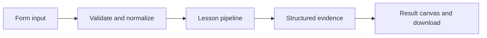

# How Secrets stay out of evidence works

Inspect required variable presence without printing values, and redact common secret patterns in log text.

## Why LangChain
LangChain supplies composable messages, prompts, model adapters, documents, or retrieval contracts. Pure local processing may be simpler without it; the lesson isolates the named engineering concept before introducing external services.

## Imports
`Path` resolves local configuration; `os` reads variable names; `json` encodes evidence; `time` measures local duration; `streamlit` renders the interface; `load_dotenv` loads optional configuration without replacing injected values. `ChatPromptTemplate` structures messages; `StrOutputParser` extracts text; `RunnableLambda` wraps Python functions; message classes represent chat roles; `ChatOpenAI` is used only by offered live paths. Additional concept-specific imports appear in the source below.

## Data flow


## Concept-specific implementation, annotated by source
Read this complete runnable core alongside app.py. Validation precedes processing; the returned dictionary defines what the UI displays.

```python
import re

def redact(text):
    text=re.sub(r'(?im)(authorization\s*:\s*bearer\s+)\S+',r'\1[REDACTED]',text)
    text=re.sub(r'(?im)((?:[A-Z_]*(?:API_KEY|TOKEN|SECRET|PASSWORD))\s*=\s*)[^\s]+',r'\1[REDACTED]',text)
    return re.sub(r'\bsk-[A-Za-z0-9_-]{8,}', '[REDACTED]',text)

def run(data,live=False,model=None):
    log=require_text(data['log'],5000)
    return {'answer':redact(log),'bindings':[{'name':name,'present':bool(os.getenv(name))} for name in ('OPENAI_API_KEY','LANGSMITH_API_KEY')],'guarantee':'best-effort teaching redactor; structured allowlisted logging is safer than arbitrary secret filtering'}
```

## Important lines
- `def redact(text):` — defines a callable stage and its input contract.
- `return re.sub(r'\bsk-[A-Za-z0-9_-]{8,}', '[REDACTED]',text)` — returns the observable result consumed by tests and the evidence canvas.
- `def run(data,live=False,model=None):` — defines a callable stage and its input contract.
- `return {'answer':redact(log),'bindings':[{'name':name,'present':bool(os.getenv(name))} for name in ('OPENAI_API_KEY','LANGSMITH_API_KEY')],'guarantee':'best-effort teaching redactor; structured allowlisted logging is safer than arbitrary secret filtering'}` — returns the observable result consumed by tests and the evidence canvas.

## Interface and reliability
The form submits related inputs together. Session state retains the last result; reset clears it. A spinner provides loading feedback. Input errors are shown in context; unknown provider errors are sanitized. Static HTML styles contain no user text. Every output carries explicit local/live labeling. The timer is not a provider latency benchmark. Local tests do not establish live provider correctness, visual browser quality, or production deployment.
