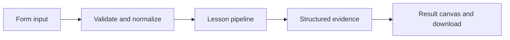

# How Failover with clear tradeoffs works

Simulate region routing and replicated revisions; block stale replicas rather than pretending failover guarantees consistency.

## Why LangChain
LangChain supplies composable messages, prompts, model adapters, documents, or retrieval contracts. Pure local processing may be simpler without it; the lesson isolates the named engineering concept before introducing external services.

## Imports
`Path` resolves local configuration; `os` reads variable names; `json` encodes evidence; `time` measures local duration; `streamlit` renders the interface; `load_dotenv` loads optional configuration without replacing injected values. `ChatPromptTemplate` structures messages; `StrOutputParser` extracts text; `RunnableLambda` wraps Python functions; message classes represent chat roles; `ChatOpenAI` is used only by offered live paths. Additional concept-specific imports appear in the source below.

## Data flow


## Concept-specific implementation, annotated by source
Read this complete runnable core alongside app.py. Validation precedes processing; the returned dictionary defines what the UI displays.

```python
def run(data,live=False,model=None):
    primary=data['primary'];replica=data['replica'];version=int(data['replica_version'])
    if primary not in ('healthy','down') or replica not in ('healthy','down') or not 0<=version<=3:raise ValueError('Invalid region state.')
    selected='primary' if primary=='healthy' else 'replica' if replica=='healthy' and version==3 else None
    return {'region':selected,'available':selected is not None,'required_revision':3,'replica_revision':version,'reason':'primary healthy' if selected=='primary' else 'replica is current' if selected else 'no healthy current revision','deployment':'deterministic local simulation; no cloud resources or replicated database created'}
```

## Important lines
- `def run(data,live=False,model=None):` — defines a callable stage and its input contract.
- `return {'region':selected,'available':selected is not None,'required_revision':3,'replica_revision':version,'reason':'primary healthy' if selected=='primary' else 'replica is current' if selected else 'no healthy current revision','deployment':'deterministic local simulation; no cloud resources or replicated database created'}` — returns the observable result consumed by tests and the evidence canvas.

## Interface and reliability
The form submits related inputs together. Session state retains the last result; reset clears it. A spinner provides loading feedback. Input errors are shown in context; unknown provider errors are sanitized. Static HTML styles contain no user text. Every output carries explicit local/live labeling. The timer is not a provider latency benchmark. Local tests do not establish live provider correctness, visual browser quality, or production deployment.
