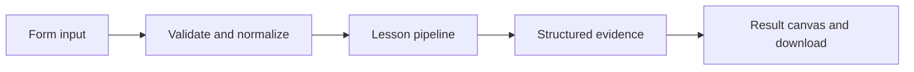

# How Read a trace tree works

Validate parent-child spans, compute wall-clock duration, and find the longest direct child without summing overlapping work.

## Why LangChain
LangChain supplies composable messages, prompts, model adapters, documents, or retrieval contracts. Pure local processing may be simpler without it; the lesson isolates the named engineering concept before introducing external services.

## Imports
`Path` resolves local configuration; `os` reads variable names; `json` encodes evidence; `time` measures local duration; `streamlit` renders the interface; `load_dotenv` loads optional configuration without replacing injected values. `ChatPromptTemplate` structures messages; `StrOutputParser` extracts text; `RunnableLambda` wraps Python functions; message classes represent chat roles; `ChatOpenAI` is used only by offered live paths. Additional concept-specific imports appear in the source below.

## Data flow


## Concept-specific implementation, annotated by source
Read this complete runnable core alongside app.py. Validation precedes processing; the returned dictionary defines what the UI displays.

```python
def run(data,live=False,model=None):
    spans=json.loads(data['spans']) if isinstance(data['spans'],str) else data['spans']
    if not isinstance(spans,list) or not 1<=len(spans)<=500:raise ValueError('Supply 1–500 spans.')
    lookup={s['id']:s for s in spans}
    if len(lookup)!=len(spans):raise ValueError('Duplicate span ID.')
    roots=[s for s in spans if s['parent'] is None]
    if len(roots)!=1:raise ValueError('Exactly one root span is required.')
    root=roots[0]
    for span in spans:
        start=float(span['start_ms']);end=float(span['end_ms'])
        if not 0<=start<=end<1e12:raise ValueError('Invalid span duration.')
        chain=set();node=span
        while node['parent'] is not None:
            if node['id'] in chain or node['parent'] not in lookup:raise ValueError('Trace has a cycle or missing parent.')
            chain.add(node['id']);parent=lookup[node['parent']]
            if node['start_ms']<parent['start_ms'] or node['end_ms']>parent['end_ms']:raise ValueError('Child span falls outside its parent.')
            node=parent
    children=[s for s in spans if s['parent']==root['id']]
    longest=max(children,key=lambda s:s['end_ms']-s['start_ms'])['id'] if children else None
    return {'root_duration_ms':root['end_ms']-root['start_ms'],'span_count':len(spans),'longest_direct_child':longest,'interpretation':'overlapping spans are not additive; longest child is not a general critical-path algorithm'}
```

## Important lines
- `def run(data,live=False,model=None):` — defines a callable stage and its input contract.
- `return {'root_duration_ms':root['end_ms']-root['start_ms'],'span_count':len(spans),'longest_direct_child':longest,'interpretation':'overlapping spans are not additive; longest child is not a general critical-path algorithm'}` — returns the observable result consumed by tests and the evidence canvas.

## Interface and reliability
The form submits related inputs together. Session state retains the last result; reset clears it. A spinner provides loading feedback. Input errors are shown in context; unknown provider errors are sanitized. Static HTML styles contain no user text. Every output carries explicit local/live labeling. The timer is not a provider latency benchmark. Local tests do not establish live provider correctness, visual browser quality, or production deployment.
