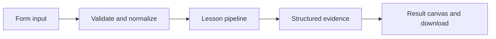

# How Follow a thread over time works

Group run records by conversation thread and compare errors, cumulative cost, and mean latency.

## Why LangChain
LangChain supplies composable messages, prompts, model adapters, documents, or retrieval contracts. Pure local processing may be simpler without it; the lesson isolates the named engineering concept before introducing external services.

## Imports
`Path` resolves local configuration; `os` reads variable names; `json` encodes evidence; `time` measures local duration; `streamlit` renders the interface; `load_dotenv` loads optional configuration without replacing injected values. `ChatPromptTemplate` structures messages; `StrOutputParser` extracts text; `RunnableLambda` wraps Python functions; message classes represent chat roles; `ChatOpenAI` is used only by offered live paths. Additional concept-specific imports appear in the source below.

## Data flow


## Concept-specific implementation, annotated by source
Read this complete runnable core alongside app.py. Validation precedes processing; the returned dictionary defines what the UI displays.

```python
import math

def validated_runs(value):
    rows=json.loads(value) if isinstance(value,str) else value
    if not isinstance(rows,list) or not 1<=len(rows)<=1000:raise ValueError('Supply 1–1000 run records.')
    ids=set()
    for row in rows:
        identifier=require_text(row['id'],80)
        if identifier in ids:raise ValueError('Run IDs must be unique.')
        ids.add(identifier)
        for key in ('latency_ms','cost_usd'):
            number=float(row[key])
            if not math.isfinite(number) or number<0:raise ValueError('Latency and cost must be finite and nonnegative.')
    return rows

def run(data,live=False,model=None):
    rows=validated_runs(data['runs']);threads={}
    for row in rows:
        thread=require_text(row['thread'],80);summary=threads.setdefault(thread,{'runs':0,'errors':0,'cost_usd':0.0,'latency_total_ms':0.0})
        summary['runs']+=1;summary['errors']+=int(bool(row.get('error',False)));summary['cost_usd']+=float(row['cost_usd']);summary['latency_total_ms']+=float(row['latency_ms'])
    for value in threads.values():
        value['mean_latency_ms']=value.pop('latency_total_ms')/value['runs'];value['cost_usd']=round(value['cost_usd'],8)
    return {'threads':threads,'thread_count':len(threads),'service':'local run export analysis, not a live LangSmith query'}
```

## Important lines
- `def validated_runs(value):` — defines a callable stage and its input contract.
- `return rows` — returns the observable result consumed by tests and the evidence canvas.
- `def run(data,live=False,model=None):` — defines a callable stage and its input contract.
- `return {'threads':threads,'thread_count':len(threads),'service':'local run export analysis, not a live LangSmith query'}` — returns the observable result consumed by tests and the evidence canvas.

## Interface and reliability
The form submits related inputs together. Session state retains the last result; reset clears it. A spinner provides loading feedback. Input errors are shown in context; unknown provider errors are sanitized. Static HTML styles contain no user text. Every output carries explicit local/live labeling. The timer is not a provider latency benchmark. Local tests do not establish live provider correctness, visual browser quality, or production deployment.
