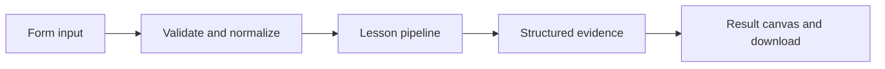

# How Feedback becomes a signal works

Aggregate explicit user sentiment by topic and separate scored online feedback from exploratory Insights-style clustering.

## Why LangChain
LangChain supplies composable messages, prompts, model adapters, documents, or retrieval contracts. Pure local processing may be simpler without it; the lesson isolates the named engineering concept before introducing external services.

## Imports
`Path` resolves local configuration; `os` reads variable names; `json` encodes evidence; `time` measures local duration; `streamlit` renders the interface; `load_dotenv` loads optional configuration without replacing injected values. `ChatPromptTemplate` structures messages; `StrOutputParser` extracts text; `RunnableLambda` wraps Python functions; message classes represent chat roles; `ChatOpenAI` is used only by offered live paths. Additional concept-specific imports appear in the source below.

## Data flow


## Concept-specific implementation, annotated by source
Read this complete runnable core alongside app.py. Validation precedes processing; the returned dictionary defines what the UI displays.

```python
def run(data,live=False,model=None):
    rows=json.loads(data['feedback']) if isinstance(data['feedback'],str) else data['feedback']
    if not isinstance(rows,list) or not 1<=len(rows)<=1000:raise ValueError('Use 1–1000 feedback records.')
    topics={}
    for row in rows:
        topic=require_text(row['topic'],80);sentiment=row['sentiment']
        if sentiment not in ('positive','negative','neutral'):raise ValueError('Unknown sentiment label.')
        counts=topics.setdefault(topic,{'positive':0,'negative':0,'neutral':0});counts[sentiment]+=1
    return {'topics':topics,'negative_share':sum(r['sentiment']=='negative' for r in rows)/len(rows),'distinction':'online evaluators score selected runs; Insights explores patterns across groups. This is local labeled aggregation, not LangSmith Insights.'}
```

## Important lines
- `def run(data,live=False,model=None):` — defines a callable stage and its input contract.
- `return {'topics':topics,'negative_share':sum(r['sentiment']=='negative' for r in rows)/len(rows),'distinction':'online evaluators score selected runs; Insights explores patterns across groups. This is local labeled aggregation, not LangSmith Insights.'}` — returns the observable result consumed by tests and the evidence canvas.

## Interface and reliability
The form submits related inputs together. Session state retains the last result; reset clears it. A spinner provides loading feedback. Input errors are shown in context; unknown provider errors are sanitized. Static HTML styles contain no user text. Every output carries explicit local/live labeling. The timer is not a provider latency benchmark. Local tests do not establish live provider correctness, visual browser quality, or production deployment.
