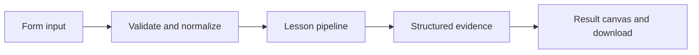

# How An alert with a reason works

Evaluate a minimum-size observation window, apply latency/error thresholds, and deduplicate local alerts.

## Why LangChain
LangChain supplies composable messages, prompts, model adapters, documents, or retrieval contracts. Pure local processing may be simpler without it; the lesson isolates the named engineering concept before introducing external services.

## Imports
`Path` resolves local configuration; `os` reads variable names; `json` encodes evidence; `time` measures local duration; `streamlit` renders the interface; `load_dotenv` loads optional configuration without replacing injected values. `ChatPromptTemplate` structures messages; `StrOutputParser` extracts text; `RunnableLambda` wraps Python functions; message classes represent chat roles; `ChatOpenAI` is used only by offered live paths. Additional concept-specific imports appear in the source below.

## Data flow


## Concept-specific implementation, annotated by source
Read this complete runnable core alongside app.py. Validation precedes processing; the returned dictionary defines what the UI displays.

```python
import math

def validated_runs(value):
    rows=json.loads(value) if isinstance(value,str) else value
    if not isinstance(rows,list) or not 1<=len(rows)<=1000:raise ValueError('Supply 1–1000 run records.')
    ids=set()
    for row in rows:
        identifier=require_text(row['id'],80)
        if identifier in ids:raise ValueError('Run IDs must be unique.')
        ids.add(identifier)
        for key in ('latency_ms','cost_usd'):
            number=float(row[key])
            if not math.isfinite(number) or number<0:raise ValueError('Latency and cost must be finite and nonnegative.')
    return rows
import sqlite3
import uuid
import hashlib
DATA_DIR=Path(__file__).with_name('.local')
from contextlib import contextmanager
@contextmanager
def connect():
    DATA_DIR.mkdir(exist_ok=True,parents=True)
    db=sqlite3.connect(DATA_DIR/'platform.sqlite')
    try:
        with db:yield db
    finally:db.close()

def run(data,live=False,model=None):
    rows=validated_runs(data['runs']);threshold=int(data['p95_threshold']);minimum=int(data['min_samples'])
    if not 1<=threshold<=10000 or not 1<=minimum<=100:raise ValueError('Invalid alert configuration.')
    values=sorted(float(r['latency_ms']) for r in rows);p95=values[math.ceil(.95*len(values))-1];errors=sum(bool(r.get('error')) for r in rows)/len(rows)
    reasons=[]
    if len(rows)>=minimum:
        if p95>threshold:reasons.append('p95_latency')
        if errors>.1:reasons.append('error_rate')
    fingerprint=hashlib.sha256(json.dumps({'ids':sorted(r['id'] for r in rows),'threshold':threshold,'minimum':minimum,'reasons':reasons},sort_keys=True).encode()).hexdigest()
    with connect() as db:
        db.execute('CREATE TABLE IF NOT EXISTS alerts(fingerprint TEXT PRIMARY KEY)')
        cursor=db.execute('INSERT OR IGNORE INTO alerts VALUES (?)',(fingerprint,)) if reasons else None
        new=bool(cursor and cursor.rowcount)
    return {'triggered':bool(reasons),'reasons':reasons,'new_alert':new,'insufficient_samples':len(rows)<minimum,'p95_ms':p95,'error_rate':errors,'delivery':'local alert ledger only; no email, webhook, or cloud alert configured'}
```

## Important lines
- `def validated_runs(value):` — defines a callable stage and its input contract.
- `return rows` — returns the observable result consumed by tests and the evidence canvas.
- `def connect():` — defines a callable stage and its input contract.
- `return sqlite3.connect(DATA_DIR/'platform.sqlite')` — returns the observable result consumed by tests and the evidence canvas.
- `def run(data,live=False,model=None):` — defines a callable stage and its input contract.
- `return {'triggered':bool(reasons),'reasons':reasons,'new_alert':new,'insufficient_samples':len(rows)<minimum,'p95_ms':p95,'error_rate':errors,'delivery':'local alert ledger only; no email, webhook, or cloud alert configured'}` — returns the observable result consumed by tests and the evidence canvas.

## Interface and reliability
The form submits related inputs together. Session state retains the last result; reset clears it. A spinner provides loading feedback. Input errors are shown in context; unknown provider errors are sanitized. Static HTML styles contain no user text. Every output carries explicit local/live labeling. The timer is not a provider latency benchmark. Local tests do not establish live provider correctness, visual browser quality, or production deployment.
