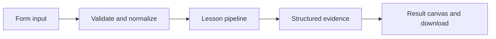

# How From candidate to monitored release works

Run a deterministic local lifecycle: validate a dataset, evaluate a candidate, apply a release gate, and persist an auditable decision.

## Why LangChain
LangChain supplies composable messages, prompts, model adapters, documents, or retrieval contracts. Pure local processing may be simpler without it; the lesson isolates the named engineering concept before introducing external services.

## Imports
`Path` resolves local configuration; `os` reads variable names; `json` encodes evidence; `time` measures local duration; `streamlit` renders the interface; `load_dotenv` loads optional configuration without replacing injected values. `ChatPromptTemplate` structures messages; `StrOutputParser` extracts text; `RunnableLambda` wraps Python functions; message classes represent chat roles; `ChatOpenAI` is used only by offered live paths. Additional concept-specific imports appear in the source below.

## Data flow


## Concept-specific implementation, annotated by source
Read this complete runnable core alongside app.py. Validation precedes processing; the returned dictionary defines what the UI displays.

```python
import re

def normalize_answer(text): return ' '.join(re.findall(r'\w+',text.casefold()))
def exact_match(prediction,reference): return normalize_answer(prediction)==normalize_answer(reference)
def token_f1(prediction,reference):
    from collections import Counter
    p=Counter(normalize_answer(prediction).split());r=Counter(normalize_answer(reference).split())
    common=sum((p&r).values())
    if not p or not r:return float(p==r)
    precision=common/sum(p.values());recall=common/sum(r.values())
    return round(2*precision*recall/(precision+recall),6) if precision+recall else 0.0
import sqlite3
import uuid
import hashlib
DATA_DIR=Path(__file__).with_name('.local')
from contextlib import contextmanager
@contextmanager
def connect():
    DATA_DIR.mkdir(exist_ok=True,parents=True)
    db=sqlite3.connect(DATA_DIR/'platform.sqlite')
    try:
        with db:yield db
    finally:db.close()

def run(data,live=False,model=None):
    rows=json.loads(data['examples']) if isinstance(data['examples'],str) else data['examples'];candidate=data['candidate'];gate=int(data['gate'])
    if not isinstance(rows,list) or not 1<=len(rows)<=100 or candidate not in ('echo','uppercase') or not 0<=gate<=100:raise ValueError('Invalid dataset, candidate, or gate.')
    results=[]
    for row in rows:
        text=require_text(row['input'],2000);reference=require_text(row['reference'],4000);prediction=text if candidate=='echo' else text.upper()
        results.append({'prediction':prediction,'correct':exact_match(prediction,reference)})
    score=sum(r['correct'] for r in results)/len(results);released=score>=gate/100;identifier=str(uuid.uuid4())
    with connect() as db:
        db.execute('CREATE TABLE IF NOT EXISTS lifecycle(id TEXT PRIMARY KEY,candidate TEXT,score REAL,released INTEGER)')
        db.execute('INSERT INTO lifecycle VALUES (?,?,?,?)',(identifier,candidate,score,int(released)))
    return {'release_id':identifier,'score':score,'released':released,'results':results,'deployment':'local release ledger; no managed deployment or production monitoring performed'}
```

## Important lines
- `def normalize_answer(text): return ' '.join(re.findall(r'\w+',text.casefold()))` — defines a callable stage and its input contract.
- `def exact_match(prediction,reference): return normalize_answer(prediction)==normalize_answer(reference)` — defines a callable stage and its input contract.
- `def token_f1(prediction,reference):` — defines a callable stage and its input contract.
- `return round(2*precision*recall/(precision+recall),6) if precision+recall else 0.0` — returns the observable result consumed by tests and the evidence canvas.
- `def connect():` — defines a callable stage and its input contract.
- `return sqlite3.connect(DATA_DIR/'platform.sqlite')` — returns the observable result consumed by tests and the evidence canvas.
- `def run(data,live=False,model=None):` — defines a callable stage and its input contract.
- `return {'release_id':identifier,'score':score,'released':released,'results':results,'deployment':'local release ledger; no managed deployment or production monitoring performed'}` — returns the observable result consumed by tests and the evidence canvas.

## Interface and reliability
The form submits related inputs together. Session state retains the last result; reset clears it. A spinner provides loading feedback. Input errors are shown in context; unknown provider errors are sanitized. Static HTML styles contain no user text. Every output carries explicit local/live labeling. The timer is not a provider latency benchmark. Local tests do not establish live provider correctness, visual browser quality, or production deployment.
