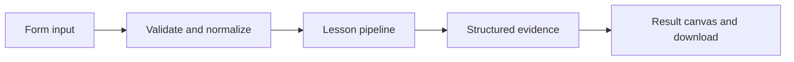

# How The enterprise knowledge room works

Filter a tenant-scoped corpus before retrieval and persist an audit of each local knowledge request.

## Why LangChain
LangChain supplies composable messages, prompts, model adapters, documents, or retrieval contracts. Pure local processing may be simpler without it; the lesson isolates the named engineering concept before introducing external services.

## Imports
`Path` resolves local configuration; `os` reads variable names; `json` encodes evidence; `time` measures local duration; `streamlit` renders the interface; `load_dotenv` loads optional configuration without replacing injected values. `ChatPromptTemplate` structures messages; `StrOutputParser` extracts text; `RunnableLambda` wraps Python functions; message classes represent chat roles; `ChatOpenAI` is used only by offered live paths. Additional concept-specific imports appear in the source below.

## Data flow


## Concept-specific implementation, annotated by source
Read this complete runnable core alongside app.py. Validation precedes processing; the returned dictionary defines what the UI displays.

```python
import hashlib
import math
import re
from langchain_core.embeddings import Embeddings
class LocalHashEmbeddings(Embeddings):
    """Deterministic lexical hashing, NOT semantic embeddings."""
    def embed_query(self,text):
        vector=[0.0]*64
        for token in re.findall(r'\w+',text.casefold()):
            index=int.from_bytes(hashlib.sha256(token.encode()).digest()[:4],'big')%64
            vector[index]+=1
        norm=math.sqrt(sum(x*x for x in vector))
        return [x/norm for x in vector] if norm else vector
    def embed_documents(self,texts): return [self.embed_query(t) for t in texts]

from langchain_core.documents import Document
from langchain_core.vectorstores import InMemoryVectorStore

def retrieve(data):
    question=require_text(data['question'],2000)
    raw=data['documents'];rows=json.loads(raw) if isinstance(raw,str) else raw
    if not isinstance(rows,list) or not 1<=len(rows)<=50: raise ValueError('Supply a JSON array of 1–50 documents.')
    docs=[Document(page_content=require_text(text,4000),metadata={'source':f'doc-{i+1}'}) for i,text in enumerate(rows)]
    store=InMemoryVectorStore(LocalHashEmbeddings());store.add_documents(docs)
    if not any(LocalHashEmbeddings().embed_query(question)): return question,[]
    matches=store.similarity_search_with_score(question,k=min(3,len(docs)))
    return question,[{'source':d.metadata['source'],'text':d.page_content,'score':round(float(score),6)} for d,score in matches if float(score)>0]
import sqlite3
import uuid
import hashlib
DATA_DIR=Path(__file__).with_name('.local')
from contextlib import contextmanager
@contextmanager
def connect():
    DATA_DIR.mkdir(exist_ok=True,parents=True)
    db=sqlite3.connect(DATA_DIR/'platform.sqlite')
    try:
        with db:yield db
    finally:db.close()

def answer_for_tenant(claims,question,records):
    tenant=claims.get('tenant')
    if tenant not in ('team-a','team-b'):raise ValueError('Authenticated tenant claim is required.')
    if not isinstance(records,list) or not 1<=len(records)<=50:raise ValueError('Supply 1–50 tenant records.')
    selected=[]
    for row in records:
        if row['tenant']==tenant:selected.append(require_text(row['text'],4000))
    if not selected:return {'answer':'No authorized evidence.','evidence':[],'sources':[]}
    _,matches=retrieve({'question':question,'documents':selected})
    return {'answer':' '.join('['+m['source']+'] '+m['text'] for m in matches) if matches else 'No authorized evidence.','evidence':matches,'sources':[m['source'] for m in matches]}

def run(data,live=False,model=None):
    tenant=data['tenant'];question=require_text(data['question'],2000)
    rows=json.loads(data['records']) if isinstance(data['records'],str) else data['records']
    # This selector is a demo identity; production must supply verified server-side claims.
    result=answer_for_tenant({'tenant':tenant},question,rows)
    with connect() as db:
        db.execute('CREATE TABLE IF NOT EXISTS retrieval_audit(id TEXT PRIMARY KEY,tenant TEXT,sources TEXT)')
        identifier=str(uuid.uuid4());db.execute('INSERT INTO retrieval_audit VALUES (?,?,?)',(identifier,tenant,json.dumps(result['sources'])))
    return {**result,'tenant':tenant,'audit_id':identifier,'identity':'demo tenant selector; not production authentication','retrieval':'tenant filtering before lexical-hash vector search'}
```

## Important lines
- `def embed_query(self,text):` — defines a callable stage and its input contract.
- `return [x/norm for x in vector] if norm else vector` — returns the observable result consumed by tests and the evidence canvas.
- `def embed_documents(self,texts): return [self.embed_query(t) for t in texts]` — defines a callable stage and its input contract.
- `def retrieve(data):` — defines a callable stage and its input contract.
- `return question,[{'source':d.metadata['source'],'text':d.page_content,'score':round(float(score),6)} for d,score in matches if float(score)>0]` — returns the observable result consumed by tests and the evidence canvas.
- `def connect():` — defines a callable stage and its input contract.
- `return sqlite3.connect(DATA_DIR/'platform.sqlite')` — returns the observable result consumed by tests and the evidence canvas.
- `def answer_for_tenant(claims,question,records):` — defines a callable stage and its input contract.
- `return {'answer':' '.join('['+m['source']+'] '+m['text'] for m in matches) if matches else 'No authorized evidence.','evidence':matches,'sources':[m['source'] for m in matches]}` — returns the observable result consumed by tests and the evidence canvas.
- `def run(data,live=False,model=None):` — defines a callable stage and its input contract.
- `return {**result,'tenant':tenant,'audit_id':identifier,'identity':'demo tenant selector; not production authentication','retrieval':'tenant filtering before lexical-hash vector search'}` — returns the observable result consumed by tests and the evidence canvas.

## Interface and reliability
The form submits related inputs together. Session state retains the last result; reset clears it. A spinner provides loading feedback. Input errors are shown in context; unknown provider errors are sanitized. Static HTML styles contain no user text. Every output carries explicit local/live labeling. The timer is not a provider latency benchmark. Local tests do not establish live provider correctness, visual browser quality, or production deployment.
