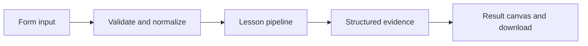

# How Support with a review gate works

Route support requests, persist approval checkpoints for financial actions, and resume only after a human decision.

## Why LangChain
LangChain supplies composable messages, prompts, model adapters, documents, or retrieval contracts. Pure local processing may be simpler without it; the lesson isolates the named engineering concept before introducing external services.

## Imports
`Path` resolves local configuration; `os` reads variable names; `json` encodes evidence; `time` measures local duration; `streamlit` renders the interface; `load_dotenv` loads optional configuration without replacing injected values. `ChatPromptTemplate` structures messages; `StrOutputParser` extracts text; `RunnableLambda` wraps Python functions; message classes represent chat roles; `ChatOpenAI` is used only by offered live paths. Additional concept-specific imports appear in the source below.

## Data flow


## Concept-specific implementation, annotated by source
Read this complete runnable core alongside app.py. Validation precedes processing; the returned dictionary defines what the UI displays.

```python
from typing_extensions import TypedDict
from langgraph.graph import StateGraph, START, END

from langgraph.types import interrupt,Command
from langgraph.checkpoint.sqlite import SqliteSaver
from langsmith import traceable,tracing_context
DATA_DIR=Path(__file__).with_name('.local')
class SupportState(TypedDict):
    message:str
    route:str
    answer:str
    approved:bool

def build_support(saver):
    graph=StateGraph(SupportState)
    graph.add_node('route',lambda s:{'route':'financial' if any(w in s['message'].lower() for w in ('refund','payment')) else 'technical'})
    def review(state):
        decision=interrupt({'request':state['message'],'action':'Review financial request. No transaction will be performed.'})
        return {'approved':decision=='approve','answer':'Draft approved for staff follow-up.' if decision=='approve' else 'Draft rejected; escalate to a human.'}
    graph.add_node('review',review)
    graph.add_node('technical',lambda s:{'answer':'Please provide reproduction steps and your app version.','approved':False})
    graph.add_edge(START,'route');graph.add_conditional_edges('route',lambda s:'review' if s['route']=='financial' else 'technical',{'review':'review','technical':'technical'});graph.add_edge('review',END);graph.add_edge('technical',END)
    return graph.compile(checkpointer=saver)

@traceable(name='support-request',process_inputs=lambda _: {'request':'[redacted]'},process_outputs=lambda _: {'response':'[redacted]'})
def process_support(data):
    thread=require_text(data['thread'],80);message=require_text(data['message'],2000);decision=data['decision']
    if decision not in ('submit','approve','reject'):raise ValueError('Invalid decision.')
    DATA_DIR.mkdir(exist_ok=True,parents=True)
    with SqliteSaver.from_conn_string(str(DATA_DIR/'support.sqlite')) as saver:
        graph=build_support(saver);config={'configurable':{'thread_id':thread}};snapshot=graph.get_state(config)
        if decision=='submit':
            if snapshot.next:raise ValueError('Review the pending request first.')
            result=graph.invoke({'message':message,'approved':False,'answer':'Awaiting staff approval.'},config)
        else:
            if not snapshot.next:raise ValueError('Submit a financial request before reviewing.')
            result=graph.invoke(Command(resume=decision),config)
        return {'thread':thread,'route':result['route'],'answer':result['answer'],'pending':bool(result.get('__interrupt__')),'approved':result['approved'],'external_effects':'none; this app drafts responses and never issues refunds','identity':'local reviewer simulation; production requires authenticated staff authorization'}

def run(data,live=False,model=None):
    with tracing_context(enabled=False):return process_support(data)
```

## Important lines
- `def build_support(saver):` — defines a callable stage and its input contract.
- `def review(state):` — defines a callable stage and its input contract.
- `return {'approved':decision=='approve','answer':'Draft approved for staff follow-up.' if decision=='approve' else 'Draft rejected; escalate to a human.'}` — returns the observable result consumed by tests and the evidence canvas.
- `return graph.compile(checkpointer=saver)` — returns the observable result consumed by tests and the evidence canvas.
- `def process_support(data):` — defines a callable stage and its input contract.
- `result=graph.invoke({'message':message,'approved':False,'answer':'Awaiting staff approval.'},config)` — executes the composed pipeline with the prepared input.
- `result=graph.invoke(Command(resume=decision),config)` — executes the composed pipeline with the prepared input.
- `return {'thread':thread,'route':result['route'],'answer':result['answer'],'pending':bool(result.get('__interrupt__')),'approved':result['approved'],'external_effects':'none; this app drafts responses and never issues refunds','identity':'local reviewer simulation; production requires authenticated staff authorization'}` — returns the observable result consumed by tests and the evidence canvas.
- `def run(data,live=False,model=None):` — defines a callable stage and its input contract.

## Interface and reliability
The form submits related inputs together. Session state retains the last result; reset clears it. A spinner provides loading feedback. Input errors are shown in context; unknown provider errors are sanitized. Static HTML styles contain no user text. Every output carries explicit local/live labeling. The timer is not a provider latency benchmark. Local tests do not establish live provider correctness, visual browser quality, or production deployment.
