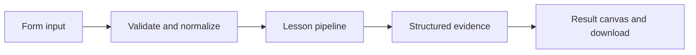

# How The agent engineering control room works

Combine retrieval, grounded answering, reference evaluation, release gating, and a persistent run dashboard in one local lifecycle.

## Why LangChain
LangChain supplies composable messages, prompts, model adapters, documents, or retrieval contracts. Pure local processing may be simpler without it; the lesson isolates the named engineering concept before introducing external services.

## Imports
`Path` resolves local configuration; `os` reads variable names; `json` encodes evidence; `time` measures local duration; `streamlit` renders the interface; `load_dotenv` loads optional configuration without replacing injected values. `ChatPromptTemplate` structures messages; `StrOutputParser` extracts text; `RunnableLambda` wraps Python functions; message classes represent chat roles; `ChatOpenAI` is used only by offered live paths. Additional concept-specific imports appear in the source below.

## Data flow


## Concept-specific implementation, annotated by source
Read this complete runnable core alongside app.py. Validation precedes processing; the returned dictionary defines what the UI displays.

```python
import hashlib
import math
import re
from langchain_core.embeddings import Embeddings
class LocalHashEmbeddings(Embeddings):
    """Deterministic lexical hashing, NOT semantic embeddings."""
    def embed_query(self,text):
        vector=[0.0]*64
        for token in re.findall(r'\w+',text.casefold()):
            index=int.from_bytes(hashlib.sha256(token.encode()).digest()[:4],'big')%64
            vector[index]+=1
        norm=math.sqrt(sum(x*x for x in vector))
        return [x/norm for x in vector] if norm else vector
    def embed_documents(self,texts): return [self.embed_query(t) for t in texts]

from langchain_core.documents import Document
from langchain_core.vectorstores import InMemoryVectorStore

def retrieve(data):
    question=require_text(data['question'],2000)
    raw=data['documents'];rows=json.loads(raw) if isinstance(raw,str) else raw
    if not isinstance(rows,list) or not 1<=len(rows)<=50: raise ValueError('Supply a JSON array of 1–50 documents.')
    docs=[Document(page_content=require_text(text,4000),metadata={'source':f'doc-{i+1}'}) for i,text in enumerate(rows)]
    store=InMemoryVectorStore(LocalHashEmbeddings());store.add_documents(docs)
    if not any(LocalHashEmbeddings().embed_query(question)): return question,[]
    matches=store.similarity_search_with_score(question,k=min(3,len(docs)))
    return question,[{'source':d.metadata['source'],'text':d.page_content,'score':round(float(score),6)} for d,score in matches if float(score)>0]
import re

def normalize_answer(text): return ' '.join(re.findall(r'\w+',text.casefold()))
def exact_match(prediction,reference): return normalize_answer(prediction)==normalize_answer(reference)
def token_f1(prediction,reference):
    from collections import Counter
    p=Counter(normalize_answer(prediction).split());r=Counter(normalize_answer(reference).split())
    common=sum((p&r).values())
    if not p or not r:return float(p==r)
    precision=common/sum(p.values());recall=common/sum(r.values())
    return round(2*precision*recall/(precision+recall),6) if precision+recall else 0.0
import sqlite3
import uuid
import hashlib
DATA_DIR=Path(__file__).with_name('.local')
from contextlib import contextmanager
@contextmanager
def connect():
    DATA_DIR.mkdir(exist_ok=True,parents=True)
    db=sqlite3.connect(DATA_DIR/'platform.sqlite')
    try:
        with db:yield db
    finally:db.close()

from langsmith import traceable,tracing_context
@traceable(name='platform-answer',process_inputs=lambda _: {'input':'[redacted]'},process_outputs=lambda _: {'output':'[redacted]'})
def answer_question(data,live=False,model=None):
    question,evidence=retrieve(data)
    context='\n'.join('['+m['source']+'] '+m['text'] for m in evidence)
    answer=ask('Answer only using supplied evidence. Cite source IDs. Abstain if unsupported.',question+'\n'+context,model) if evidence and (live or model is not None) else context or 'No evidence found.'
    return answer,evidence

def run(data,live=False,model=None):
    reference=require_text(data['reference'],4000);gate=int(data['gate'])
    if not 0<=gate<=100:raise ValueError('Release threshold must be 0–100.')
    started=time.perf_counter()
    with tracing_context(enabled=False):answer,evidence=answer_question(data,live,model)
    # Evaluate retrieved evidence separately from prose/citation formatting.
    score=max((token_f1(m['text'],reference) for m in evidence),default=0.0)
    duration=(time.perf_counter()-started)*1000;identifier=str(uuid.uuid4());released=score>=gate/100
    with connect() as db:
        db.execute('CREATE TABLE IF NOT EXISTS platform_runs(id TEXT PRIMARY KEY,latency_ms REAL,score REAL,released INTEGER)')
        db.execute('INSERT INTO platform_runs VALUES (?,?,?,?)',(identifier,duration,score,int(released)))
        history=db.execute('SELECT id,latency_ms,score,released FROM platform_runs ORDER BY rowid DESC LIMIT 20').fetchall()
    return {'answer':answer,'evidence':evidence,'evidence_token_f1':score,'gate_passed':released,'run_id':identifier,'latency_ms':round(duration,3),'recent_runs':[{'id':i,'latency_ms':round(t,3),'score':s,'gate_passed':bool(g)} for i,t,s,g in history],'readiness':'local teaching platform; retrieval score does not certify generated answer correctness; no cloud release, token billing, or production alert delivery'}
```

## Important lines
- `def embed_query(self,text):` — defines a callable stage and its input contract.
- `return [x/norm for x in vector] if norm else vector` — returns the observable result consumed by tests and the evidence canvas.
- `def embed_documents(self,texts): return [self.embed_query(t) for t in texts]` — defines a callable stage and its input contract.
- `def retrieve(data):` — defines a callable stage and its input contract.
- `return question,[{'source':d.metadata['source'],'text':d.page_content,'score':round(float(score),6)} for d,score in matches if float(score)>0]` — returns the observable result consumed by tests and the evidence canvas.
- `def normalize_answer(text): return ' '.join(re.findall(r'\w+',text.casefold()))` — defines a callable stage and its input contract.
- `def exact_match(prediction,reference): return normalize_answer(prediction)==normalize_answer(reference)` — defines a callable stage and its input contract.
- `def token_f1(prediction,reference):` — defines a callable stage and its input contract.
- `return round(2*precision*recall/(precision+recall),6) if precision+recall else 0.0` — returns the observable result consumed by tests and the evidence canvas.
- `def connect():` — defines a callable stage and its input contract.
- `return sqlite3.connect(DATA_DIR/'platform.sqlite')` — returns the observable result consumed by tests and the evidence canvas.
- `def answer_question(data,live=False,model=None):` — defines a callable stage and its input contract.
- `return answer,evidence` — returns the observable result consumed by tests and the evidence canvas.
- `def run(data,live=False,model=None):` — defines a callable stage and its input contract.
- `return {'answer':answer,'evidence':evidence,'evidence_token_f1':score,'gate_passed':released,'run_id':identifier,'latency_ms':round(duration,3),'recent_runs':[{'id':i,'latency_ms':round(t,3),'score':s,'gate_passed':bool(g)} for i,t,s,g in history],'readiness':'local teaching platform; retrieval score does not certify generated answer correctness; no cloud release, token billing, or production alert delivery'}` — returns the observable result consumed by tests and the evidence canvas.

## Interface and reliability
The form submits related inputs together. Session state retains the last result; reset clears it. A spinner provides loading feedback. Input errors are shown in context; unknown provider errors are sanitized. Static HTML styles contain no user text. Every output carries explicit local/live labeling. The timer is not a provider latency benchmark. Local tests do not establish live provider correctness, visual browser quality, or production deployment.
